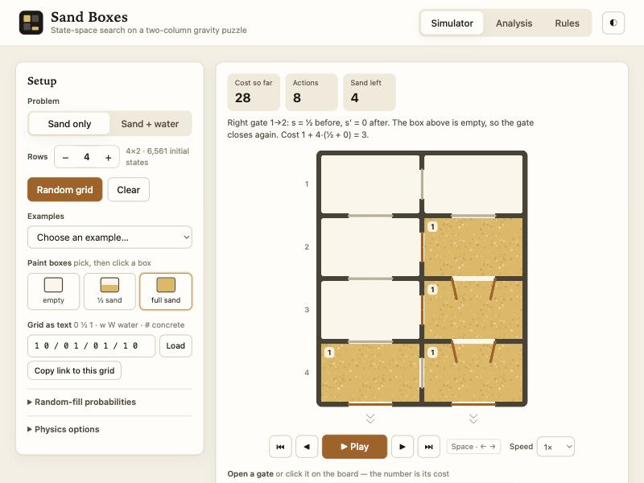
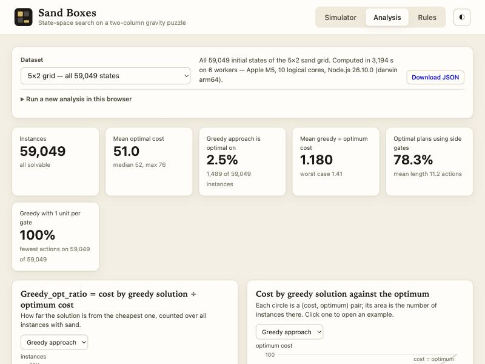
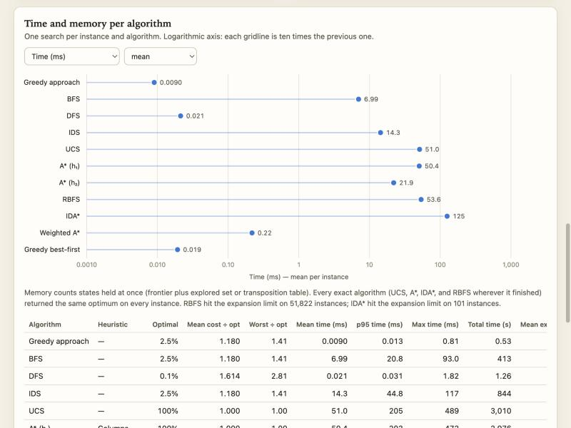

# Sand Boxes

A two-column gravity puzzle, modelled as a state-space search problem and solved with the greedy
approach from class and nine search algorithms — with an animated simulator, a solver you can
watch, and a full benchmark over every one of the 59,049 initial states of the 5×2 grid.

Everything runs in the browser as a static site (no build step, no dependencies), so it can be
hosted on GitHub Pages as is.

**Live site:** <https://soyapo.github.io/sand-boxes/> · **Repository:** <https://github.com/soyapo/sand-boxes>







## What is in the box

| | |
|---|---|
| **Simulator** | Any grid from 1×2 to 7×2. Paint boxes, generate random grids with the assignment's probabilities, open gates by hand and watch the sand fall through them. Open gates are drawn open. Every step is explained in words: the level of the upper box before and after (s, s′), what flowed, whether the gate stayed open, and how that adds up to the cost. Grids can be shared as links, and the player works from the keyboard (Space, ← →, Home, End). |
| **Solver** | The greedy approach of the assignment (straight-down sweep, no side gates), the four main searches (BFS, DFS, IDS, UCS) and the informed ones (A*, RBFS, IDA*, Weighted A*, greedy best-first) with heuristics designed for this problem. The solution is animated step by step with its cost; "Compare all" runs everything on the same grid. |
| **Analysis** | For all 3¹⁰ = 59,049 initial states: histogram of `Greedy_opt_ratio`, scatter of greedy cost against the optimum, scatter of actions against side-gate actions, time and memory of every algorithm, and a check of the claim that the greedy approach is optimal when every gate costs one unit. Click any point to open an example in the simulator. New analyses can be run in the browser. |
| **Water variant** | The proposed extension: water, concrete that blocks a box for good, +10 per concrete box, goal "no sand left". Same simulator, same solvers, benchmarked on 1,000 random instances. |
| **Rules** | The problem statement, the worked example from the assignment, and a summary of algorithms and heuristics. |

## Team and how this was built

| | |
|---|---|
| **soyapo** | [github.com/soyapo](https://github.com/soyapo) |
| **Kia Sheikhi** | [github.com/kia8506](https://github.com/kia8506) |

This is a group project for the Artificial Intelligence course (search algorithms). The assignment
is a "vibe coding" exercise: the code was written with an AI coding assistant (Claude Code), which
we directed, checked and corrected. The exported conversation is in [chats/](chats/), including
the points where the model's first reading of the physics was wrong and we corrected it.

What came from us rather than from the model: the statement of the problem; the rule of the spring gates ("a gate stays open
as long as there is sand above it, and everything falls at the same moment");
the state-by-state trace of the assignment's side-gate plan that pinned down how the spring gates work; the
definition of the greedy approach as it was explained in class; and the decision of what to
measure. What the model did: the implementation, the heuristics and their proofs, the benchmark
and the write-up, all of which we reviewed.

## Deliverables

| Required item | Where |
|---|---|
| Source code, documentation and scripts to install and run | this repository; see [Running locally](#running-locally) |
| Description of the original problem | [docs/01-problem-original.md](docs/01-problem-original.md) · [فارسی](docs/01-problem-original.fa.md) |
| Description of the proposed form of the problem | [docs/02-problem-water-variant.md](docs/02-problem-water-variant.md) · [فارسی](docs/02-problem-water-variant.fa.md) |
| Execution report and evaluation of the search algorithms | [docs/03-report.md](docs/03-report.md) · [فارسی](docs/03-report.fa.md) |
| Full text of the chats with the AI model | [chats/](chats/) |

Bonus items: graphical animation of the solution (Simulator tab), optimal solutions for all 59,049
states with the histogram and both scatter plots (Analysis tab), and time and memory of every
algorithm over all 59,049 states (Analysis tab and report).

## Running locally

You need [Node.js](https://nodejs.org) 18 or newer. Nothing has to be installed.

```bash
npm start
```

Then open <http://localhost:8080>. (The page must be served over http; opening `index.html`
directly from disk does not work because browsers block module scripts and workers on `file://`.)
Any static server works just as well, e.g. `python3 -m http.server 8080`.

Run the tests:

```bash
npm test
```

Solve a grid from the command line (cells: `0` empty, `½` half sand, `1` full sand, `w`/`W` half/full water, `#` concrete):

```bash
node scripts/solve.mjs "1 0 / 0 1 / 0 1 / 1 0"
```

```bash
node scripts/solve.mjs "1 0 / 0 1 / 0 1 / 1 0" --all
```

```bash
node scripts/solve.mjs "1 0 / 0 1 / 0 1 / 1 0" --algo sweep
```

Regenerate the datasets shown in the Analysis tab (uses worker threads; the 59,049-state run takes
roughly half an hour on four cores, dominated by IDA*, RBFS and IDS):

```bash
npm run analyze
```

A single custom run, for instance a sample with another door rule:

```bash
node scripts/analyze.mjs --rows 5 --sample 2000 --chain always --out data/custom.json
```

## Deploying to GitHub Pages

1. Create a repository on GitHub and push this folder to it (the `main` branch).
2. In the repository: **Settings → Pages → Build and deployment → Source: "Deploy from a branch"**,
   branch `main`, folder `/ (root)`. Save.
3. After a minute the site is live at `https://<your-user>.github.io/<your-repo>/`.

All paths in the site are relative, so it works under any repository name. The empty `.nojekyll`
file tells GitHub Pages to serve the files untouched.

## Project layout

```
index.html              the page (three tabs: Simulator, Analysis, Rules)
css/style.css           styles, light and dark theme
js/core/model.js        state, physics, actions, cost function (sand, water, concrete)
js/core/search.js       greedy approach, BFS, DFS, IDS, UCS, A*, RBFS, IDA*, Weighted A*, greedy best-first
js/core/heuristics.js   h₀ zero, h₁ sand volume, h₂ volume + gates, h₃ fall distance
js/core/problem.js      glue between model and search (memoised successors)
js/core/analysis.js     batch evaluation: transition table, optimal costs, statistics
js/ui/app.js            simulator and solver panel
js/ui/board.js          canvas rendering and animation
js/ui/charts.js         SVG charts (histogram, bubble scatter, dot plot, lines)
js/ui/analysis-ui.js    Analysis tab, live runs in web workers
js/worker.js            background worker (single searches and batches)
scripts/serve.mjs       local static server              (npm start)
scripts/solve.mjs       command-line solver              (npm run solve -- "...")
scripts/analyze.mjs     batch evaluation, writes data/   (npm run analyze)
scripts/figures.mjs     report figures (docs/figures) and tables from data/
data/*.json             precomputed results read by the Analysis tab
tests/sandbox.test.mjs  tests                            (npm test)
docs/                   problem statements and report (English and Persian)
chats/                  transcripts of the AI chats
```

The `js/core` modules have no browser dependencies: the same code runs in the page, in web workers
and in Node.

## The model in one paragraph

A state is the level (0, ½, 1) of each of the 2n boxes plus the set of open top-down gates.
**Action a** opens the gate under a box that holds sand (even if the box below is full): the gate
stays open as long as there is material above it and closes by itself when that box empties;
everything that can flow through the open gates flows at the same moment. It costs
`1 + 4·(s + s′)` with `s`, `s′` the level of the box above the gate before and after. **Action b**
opens a side gate: a full box and an empty one become two half boxes, cost 1; the side gate closes
at once. The goal is an empty grid.

On the assignment's worked example this gives 47 for the greedy approach, 45 for the side-gate
plan and 46 for the "other alternative", exactly as printed. The optimum found by search is 38;
see [docs/01-problem-original.md](docs/01-problem-original.md).
