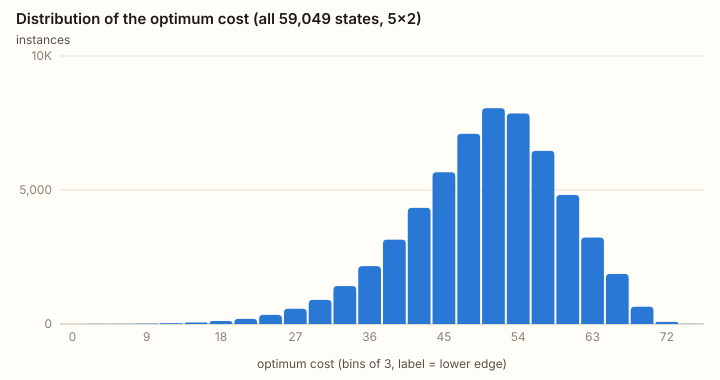
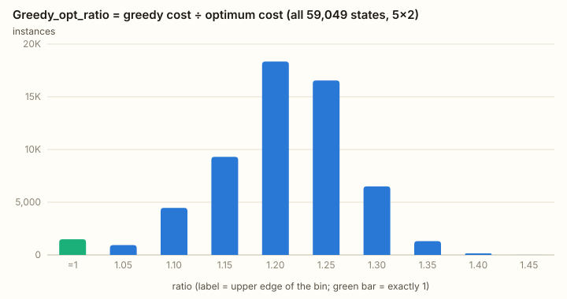
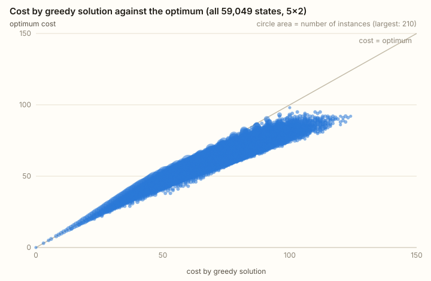
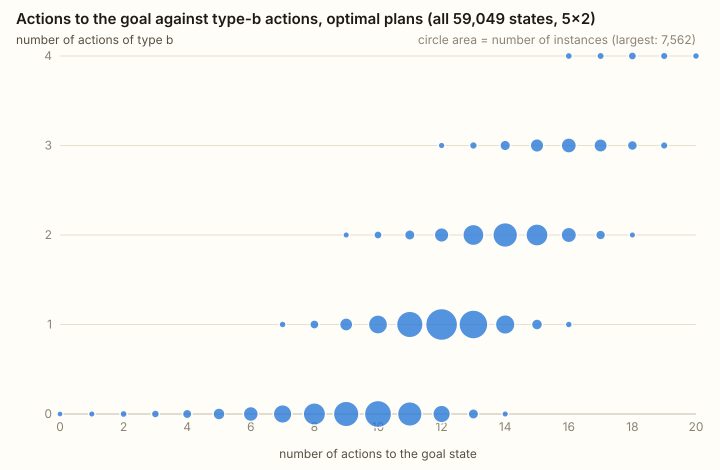
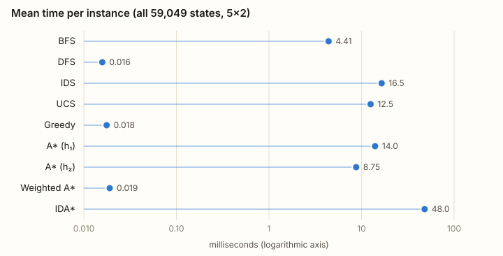
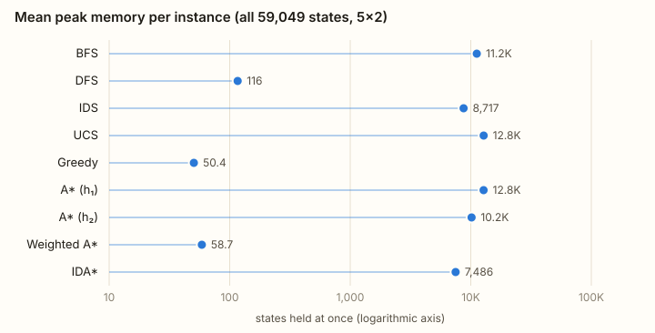
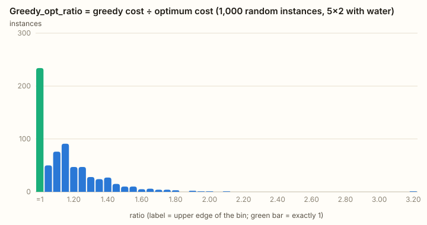

# جعبه‌های شن — گزارش اجرا و ارزیابی الگوریتم‌ها

*(English version, with every table: [03-report.md](03-report.md))*

همهٔ اعداد این گزارش از فایل‌های JSON پوشهٔ ‎`data/`‎ خوانده شده‌اند که با ‎`npm run analyze`‎ ساخته می‌شوند؛ شکل‌ها با ‎`node scripts/figures.mjs`‎ از همان فایل‌ها تولید شده‌اند. نسخهٔ تعاملی نمودارها در زبانهٔ *Analysis* سایت است.

## ۱. چه چیزی اجرا شد

| | |
|---|---|
| آزمایش اصلی | **همهٔ ۵۹٬۰۴۹ حالت اولیهٔ ممکن** جدول ۵×۲ (با احتساب بیت‌های دریچه ۳۲۶٬۰۴۱ حالت دسترس‌پذیر) |
| آزمایش‌های دیگر | همهٔ حالت‌های اولیهٔ جدول‌های ۲×۲، ۳×۲ و ۴×۲؛ و ۱۰۰۰ نمونهٔ تصادفی ۵×۲ از شکل پیشنهادی (با آب) |
| الگوریتم‌های الزامی | راهکار حریصانهٔ تکلیف؛ BFS، DFS، IDS، UCS |
| الگوریتم‌های امتیازی | ‎A*‎ با h₁، ‎A*‎ با h₂، RBFS، ‎IDA*‎، ‎A*‎ وزن‌دار (w=2)، حریصانهٔ اول‌بهترین (h₃) |
| تعداد اجرا | ۱۱ اجرا برای هر حالت؛ در مجموع ۶۴۹٬۵۳۹ اجرا |
| ماشین | Apple M5 (۱۰ هستهٔ منطقی)، Node.js 26.10، شش نخ کارگر |
| زمان کل | ۳۱۹۴ ثانیه (مجموع زمان جستجوها ۱۹٬۱۰۱ ثانیه: ‎IDA*‎ ۳۹٪، RBFS ۱۷٪، UCS ۱۶٪) |

تعریف‌ها:

- **دریچه‌های فنری:** دریچهٔ بالا‌به‌پایینی که با کنش باز شود تا وقتی رویش ماده هست باز می‌ماند و با خالی شدن جعبهٔ بالایش خودبه‌خود بسته می‌شود؛ همه‌چیز هم‌زمان از دریچه‌های باز جاری می‌شود. s′ در هزینهٔ ‎`1 + 4·(s + s′)`‎ پس از آرام گرفتنِ همه‌چیز خوانده می‌شود.
- **راهکار حریصانه** همان روالی است که در کلاس تعریف شد، نه جستجوی حریصانهٔ اول‌بهترین: هیچ دریچهٔ کناری باز نمی‌شود و هر ستون مستقل تخلیه می‌شود؛ از بالاترین جعبهٔ شن‌دار شروع می‌کنیم، دریچهٔ زیرش را باز می‌کنیم، به جعبهٔ پایین‌تر می‌رویم تا خروجی، و این پیمایش را تا خالی شدن ستون تکرار می‌کنیم. هزینهٔ آن همان «cost by greedy solution» در هیستوگرام و نمودار پراکندگی اول است.
- **هزینهٔ بهینه** دو بار و مستقل محاسبه شده است: با تکرار مقدار (value iteration) روی کل گراف حالتِ دسترس‌پذیر، و با جستجوهای دقیق.
- **زمان**: زمان واقعی یک اجرا (فقط خودِ جستجو). شش کارگر هم‌زمان روی ماشینی با چهار هستهٔ پرسرعت اجرا شده‌اند، پس زمان‌های مطلق کمی بدبینانه‌اند؛ نسبت بین الگوریتم‌ها تغییر نمی‌کند چون هر حالت همهٔ یازده الگوریتم را روی یک کارگر اجرا می‌کند.
- **حافظه**: بیشینهٔ تعداد حالت‌هایی که هم‌زمان نگه داشته می‌شوند.
- **سقف‌ها:** ۲٬۰۰۰٬۰۰۰ بسط برای هر اجرا؛ برای RBFS که جستجوی درختیِ خالص است ۵۰۰٬۰۰۰.

## ۲. آزمون‌های درستی

| آزمون | نتیجه |
|---|---|
| راهکار حریصانه روی مثال صورت تکلیف | ‎5, 5, 9, 5‎ و سپس ‎9, 9, 5‎ = ۴۷؛ همان دنبالهٔ کلاس با همان ترتیب |
| راه‌حل دریچه‌های کناری، ‎1+1، 7+9+9+5، 3+5+5‎ | ۴۵، هزینهٔ هر گام مطابق متن؛ ردِ حالت‌به‌حالت روی جدول ۵×۲ با وضعیت دریچه‌ها می‌خواند |
| «جایگزین دیگر»، ‎1+1، 3+5+9+9+5، 3+5+5‎ | ۴۶، هزینهٔ هر گام مطابق متن |
| بهینهٔ مثال صورت تکلیف | **۳۸** با UCS، ‎A*‎، ‎IDA*‎ و RBFS |
| مقایسهٔ جستجوهای دقیق با تکرار مقدار روی هر ۵۹٬۰۴۹ حالت | **صفر مغایرت** |
| قابل‌قبول و سازگار بودن h₁ و h₂ روی همهٔ حالت‌ها و گذارهای دسترس‌پذیر جدول‌های ۱×۲ تا ۵×۲ | بدون نقض (۳۲۶٬۰۴۱ حالت و ۲٫۳ میلیون گذار برای ۵×۲) |
| نمونهٔ حل‌ناپذیر (با بتن) | همهٔ الگوریتم‌ها پایان می‌یابند و «بدون جواب» گزارش می‌کنند |

## ۳. نتایج روی هر ۵۹٬۰۴۹ حالت

### ۳٫۱ جواب‌های بهینه

- هزینهٔ بهینه: میانگین ۵۱٫۰، میانه ۵۲، صدک ۹۵ برابر ۶۵، بیشینه ۷۶.
- طول برنامهٔ بهینه: میانگین ۱۱٫۲ کنش، بیشینه ۱۸.
- گران‌ترین حالت ‎`1 1 / 1 1 / 1 1 / 0 0 / 0 0`‎ است (بهینه ۷۶): شش جعبهٔ پر بالای جدول بدون چیزی زیرشان، پس هر دریچه باید زیر جعبهٔ سنگین باز شود. جدول کاملاً پر ۷۲ هزینه دارد (حریصانه ۸۲ می‌پردازد).
- **در ۷۸٫۳٪ حالت‌ها برنامهٔ بهینه دست‌کم یک دریچهٔ کناری دارد.**

| تعداد دریچهٔ کناری در برنامهٔ بهینه | ۰ | ۱ | ۲ | ۳ | ۴ | ۵ |
|---|---:|---:|---:|---:|---:|---:|
| تعداد حالت | 12,838 | 24,579 | 16,807 | 4,557 | 264 | 4 |
| سهم | 21.7% | 41.6% | 28.5% | 7.7% | 0.4% | 0.01% |

### ۳٫۲ هیستوگرام ‎`Greedy_opt_ratio`‎

‎`Greedy_opt_ratio = cost by greedy solution / optimum cost`‎

| نسبت | تعداد حالت | سهم |
|---|---:|---:|
| دقیقاً ۱ (حریصانه بهینه است) | 1,488 | 2.5% |
| ‎(1.00, 1.05)‎ | 934 | 1.6% |
| ‎[1.05, 1.10)‎ | 4,464 | 7.6% |
| ‎[1.10, 1.15)‎ | 9,304 | 15.8% |
| ‎[1.15, 1.20)‎ | 18,342 | 31.1% |
| ‎[1.20, 1.25)‎ | 16,546 | 28.0% |
| ‎[1.25, 1.30)‎ | 6,504 | 11.0% |
| ‎[1.30, 1.35)‎ | 1,310 | 2.2% |
| ‎[1.35, 1.40)‎ | 149 | 0.3% |
| ‎[1.40, 1.45)‎ | 7 | 0.01% |

میانگین ۱٫۱۸۰، میانه ۱٫۱۸۶، صدک ۹۵ برابر ۱٫۲۷۹، بیشینه ۱٫۴۱۳.

- راهکار حریصانه فقط در **۲٫۵٪** حالت‌ها بهینه است و به‌طور میانگین **۱۸٪ بیشتر** می‌پردازد (حداکثر ۴۲٪).
- بدترین حالت: ‎`1 0 / 1 ½ / 0 1 / ½ 0 / 1 0`‎ با هزینهٔ حریصانهٔ ۶۵ در برابر بهینهٔ ۴۶.
- دو دلیل برای باخت آن هست: هرگز دریچهٔ کناری باز نمی‌کند (۷۸٪ برنامه‌های بهینه به آن نیاز دارند)، و هر دریچه را وقتی باز می‌کند که جعبهٔ بالایش سنگین است (۹ برای جعبهٔ پر)، در حالی که برنامه‌های بهینه اول نیم‌جعبه‌ها را جابه‌جا می‌کنند (۳) و دریچه‌ها را وقتی ارزان‌اند باز می‌کنند.

### ۳٫۳ ادعای کلاس: بهینه بودن با هزینهٔ یک واحد برای هر دریچه

در کلاس گفته شد که راهکار حریصانه با تابع هزینهٔ معمولی (یک واحد برای هر دریچه) جواب بهینه می‌دهد. با هزینهٔ واحد، بهینه همان کمترین تعداد کنش است که BFS پیدا می‌کند. مقایسه روی همهٔ حالت‌ها:

| جدول | تعداد حالت | راهکار حریصانه کمترین تعداد کنش را دارد |
|---|---:|---:|
| ۲×۲ | 81 | 81 (۱۰۰٪) |
| ۳×۲ | 729 | 729 (۱۰۰٪) |
| ۴×۲ | 6,561 | 6,561 (۱۰۰٪) |
| ۵×۲ | 59,049 | **59,049 (۱۰۰٪)** |

**ادعا روی همهٔ حالت‌ها درست است.** پس کل فاصله‌ای که در بخش ۳٫۲ اندازه گرفته شد ساختهٔ تابع هزینهٔ ‎`1 + 4·(s + s′)`‎ است. (راهکار حریصانه و BFS همه‌جا برنامه‌هایی با همان طول — میانگین ۹٫۰ کنش — و این‌جا حتی با همان هزینه برمی‌گردانند.)

### ۳٫۴ نمودار پراکندگی ۱ — هزینهٔ حریصانه (x) در برابر هزینهٔ بهینه (y)

همهٔ نقطه‌ها روی قطر یا سمت راست آن‌اند؛ ابر نقطه‌ها نواری باریک است و اضافه‌پرداخت تقریباً متناسب با بهینه است (برای تقریباً همهٔ حالت‌ها بین ۵٪ و ۳۰٪).

### ۳٫۵ نمودار پراکندگی ۲ — تعداد کنش‌ها (x) در برابر تعداد کنش‌های نوع b (y)

برنامه‌های بهینه بین ۰ تا ۱۸ کنش دارند که ۰ تا ۵ تای آن‌ها دریچهٔ کناری است. برنامه‌های راهکار حریصانه همه روی محور افقی‌اند (میانگین ۹٫۰ کنش). برنامه‌های بهینه از برنامه‌های حریصانه **طولانی‌ترند** (۱۱٫۲ در برابر ۹٫۰ کنش): ارزان‌ترین برنامه چند کنش ارزانِ اضافه خرج می‌کند تا از کنش‌های گران دوری کند.

### ۳٫۶ کیفیت جواب، زمان و حافظهٔ همهٔ الگوریتم‌ها

| الگوریتم | بهینه در | میانگین هزینه ÷ بهینه | بدترین | میانگین زمان (ms) | بیشینهٔ زمان (ms) | میانگین حالت بسط‌یافته | میانگین حافظه (حالت) | بیشینهٔ حافظه |
|---|---:|---:|---:|---:|---:|---:|---:|---:|
| راهکار حریصانه | 2.5% | 1.180 | 1.41 | 0.009 | 0.81 | 9.0 | 1 | 1 |
| BFS | 2.5% | 1.180 | 1.41 | 6.99 | 93.0 | 10,718 | 16,800 | 75,854 |
| DFS | 0.1% | 1.614 | 2.81 | 0.021 | 1.82 | 26.1 | 123 | 200 |
| IDS | 2.5% | 1.180 | 1.41 | 14.3 | 117 | 27,700 | 9,324 | 45,562 |
| UCS | 100% | 1.000 | 1.00 | 51.0 | 489 | 34,994 | 35,300 | 214,737 |
| ‎A* (h₁)‎ | 100% | 1.000 | 1.00 | 50.4 | 472 | 33,132 | 34,900 | 204,927 |
| ‎A* (h₂)‎ | 100% | 1.000 | 1.00 | 21.9 | 213 | 13,976 | 22,200 | 130,701 |
| RBFS | 12.2% (هر جا تمام شد بهینه) | 1.000 | 1.00 | 53.6 | 215 | 453,000 | 95 | 130 |
| ‎IDA*‎ | 99.8% | 1.000 | 1.00 | 125 | 1,640 | 213,112 | 14,400 | 90,085 |
| ‎A*‎ وزن‌دار | 44.7% | 1.033 | 1.25 | 0.22 | 69.1 | 144 | 572 | 11,940 |
| حریصانهٔ اول‌بهترین | 4.9% | 1.251 | 1.81 | 0.019 | 1.56 | 12.1 | 54.7 | 114 |

RBFS در ۵۱٬۸۲۲ حالت (۸۷٫۸٪) به سقف ۵۰۰٬۰۰۰ بسط رسید و ‎IDA*‎ در ۱۰۱ حالت (۰٫۲٪) به سقف ۲ میلیون؛ هیچ اجرای دیگری به سقف نرسید.

### ۳٫۷ بحث

- **مسأله پهن است و بیت‌های دریچه آن را پهن‌تر می‌کنند.** برنامه‌ها حداکثر ۱۸ کنش دارند ولی UCS به‌طور میانگین ۳۵٬۰۰۰ و حداکثر ۲۰۵٬۷۰۹ حالت بسط می‌دهد؛ بیش از تعداد حالت‌های اولیه، چون دریچه‌های باز حالت‌های دسترس‌پذیر را چند برابر می‌کنند.
- **کیفیت اکتشافی تعیین‌کننده است.** h₁ (۳ برای هر ستون شن‌دار) تقریباً بی‌فایده است: فقط ۵٪ از بسط‌های UCS کم می‌کند و هیچ زمانی صرفه‌جویی نمی‌کند (میانگین ‎h/h*‎ برابر ۰٫۱۲). h₂ (۳ برای هر دریچهٔ بسته با شن بالای آن، ‎h/h*‎ برابر ۰٫۵۴) ۶۰٪ از بسط‌ها و ۵۷٪ از زمان را کم می‌کند. کران بر حسب مقدار شن، که نخستین ایدهٔ طبیعی است، در این مدل حتی قابل‌قبول نیست، چون یک کنشِ خروجی می‌تواند کل ستون را خالی کند.
- **RBFS بهای حافظهٔ خطی را نشان می‌دهد.** هرگز بیش از ۱۳۰ حالت در حافظه ندارد و هر جا تمام شود جواب بهینه می‌دهد، ولی در سقف ۵۰۰٬۰۰۰ بسط فقط ۱۲٫۲٪ حالت‌ها را تمام می‌کند: ۹۷٪ برنامه‌های تا ۶ کنش، ۷۷٪ هفت‌کنشی، ۴۸٪ هشت‌کنشی، ۲۴٪ نه‌کنشی، ۹٪ ده‌کنشی و تقریباً هیچ‌کدام از ۱۲ کنش به بالا. دلیلش جابه‌جایی‌هاست: کنش‌های دو ستون را می‌توان به شمار بسیار زیادی ترتیب در هم بافت و جستجوی درختیِ بدون جدول همان حالت‌ها را بارها بسط می‌دهد.
- **‎IDA*‎ فقط به کمک جدول جابه‌جایی از این وضع می‌گریزد** و باز هم کندترین الگوریتم دقیق است (۵٫۷ برابر کندتر از ‎A*‎ با h₂) و در ۱۰۱ حالت به سقف ۲ میلیون می‌رسد.
- **‎A*‎ وزن‌دار بهترین مصالحه است:** میانگین ۱۴۴ بسط و ۰٫۲۲ میلی‌ثانیه، با جوابی فقط ۳٫۳٪ بالاتر از بهینه (حداکثر ۲۵٪).
- **راهکار حریصانه ارزان‌ترینِ همه است:** ۹ بسط، یک حالت در حافظه و ۹ میکروثانیه؛ نزدیک به هزار برابر سریع‌تر از BFS با همان جواب.
- **کمترین کنش ≠ کمترین هزینه:** BFS و راهکار حریصانه فقط در ۲٫۵٪ حالت‌ها هزینهٔ بهینه می‌دهند.

## ۴. اثر اندازهٔ جدول

| جدول | تعداد حالت | میانگین بهینه | برنامه‌های بهینه با دریچهٔ کناری | راهکار حریصانه بهینه | میانگین حریصانه ÷ بهینه | حریصانه با هزینهٔ واحد بهینه | RBFS تمام‌شده |
|---|---:|---:|---:|---:|---:|---:|---:|
| ۲×۲ | 81 | 15.1 | 0% | 100% | 1.000 | 100% | 100% |
| ۳×۲ | 729 | 26.0 | 37.2% | 38.7% | 1.078 | 100% | 100% |
| ۴×۲ | 6,561 | 38.0 | 62.4% | 10.7% | 1.141 | 100% | 56.6% |
| ۵×۲ | 59,049 | 51.0 | 78.3% | 2.5% | 1.180 | 100% | 12.2% |

روی جدول ۲×۲ هیچ برنامهٔ بهینه‌ای دریچهٔ کناری ندارد و راهکار حریصانه همیشه بهینه است؛ با هر سطر اضافه دریچه‌های کناری ارزشمندتر و حریصانه بدتر می‌شود. هر سطر اضافه تعداد حالت‌های اولیه را ۹ برابر و بسط‌های UCS و ‎A*‎ را حدود ۱۰ برابر می‌کند.

## ۵. شکل پیشنهادی (آب و بتن)

۱۰۰۰ نمونهٔ تصادفی ۵×۲، جریمهٔ بتن ۱۰، سقف ۳۰۰٬۰۰۰ بسط برای هر اجرا.

- ۹۸۵ نمونه حل‌پذیرند و ۱۵ نمونه جواب ندارند (با اینکه هیچ حالت اولیه‌ای بتن ندارد)؛ میانگین هزینهٔ بهینه ۳۸٫۹ و بیشینه ۷۸.
- **راهکار حریصانه دیگر یک «روش» نیست:** چون همه‌چیز را مستقیم پایین می‌ریزد، شن و آب به هم می‌رسند و ستون با بتن بسته می‌شود؛ در **۳۲۷ نمونه** (که ۳۱۲ تای آن‌ها حل‌پذیرند) اصلاً به پایان نمی‌رسد. در ۶۷۳ نمونه‌ای که تمام می‌کند میانگین نسبت ۱٫۱۷۶ و بیشینه ۴٫۰۹ است.
- ‎A*‎ با h₂ تنها الگوریتم دقیقی است که همهٔ نمونه‌های حل‌پذیر را زیر سقف تمام می‌کند (UCS در ۳۸، ‎IDA*‎ در ۳۱۷ و RBFS در ۷۶۱ نمونه به سقف می‌رسند).

| الگوریتم | حل‌شده | بهینه در | میانگین هزینه ÷ بهینه | بدترین | میانگین زمان (ms) | میانگین بسط | رسیدن به سقف |
|---|---:|---:|---:|---:|---:|---:|---:|
| راهکار حریصانه | 673 | 20.3% | 1.176 | 4.09 | 0.024 | 5.7 | 0 |
| BFS | 1,000 | 22.3% | 1.217 | 3.67 | 21.8 | 6,353 | 0 |
| DFS | 1,000 | 2.1% | 1.940 | 14.00 | 6.51 | 2,632 | 0 |
| IDS | 996 | 22.3% | 1.217 | 3.67 | 21.5 | 15,400 | 4 |
| UCS | 962 | 97.7% | 1.000 | 1.00 | 250 | 43,300 | 38 |
| ‎A* (h₁)‎ | 983 | 99.8% | 1.000 | 1.00 | 202 | 30,400 | 17 |
| ‎A* (h₂)‎ | 985 | 100% | 1.000 | 1.00 | 192 | 29,000 | 15 |
| RBFS | 239 | 24.3% | 1.000 | 1.00 | 105 | 236,000 | 761 |
| ‎IDA*‎ | 683 | 69.3% | 1.000 | 1.00 | 235 | 131,000 | 317 |
| ‎A*‎ وزن‌دار | 996 | 94.0% | 1.004 | 1.22 | 125 | 18,400 | 4 |
| حریصانهٔ اول‌بهترین | 1,000 | 17.9% | 1.278 | 2.83 | 2.72 | 979 | 0 |

(«حل‌شده» یعنی اجرا به پایان رسیده است؛ BFS، DFS و حریصانهٔ اول‌بهترین ۱۵ نمونهٔ حل‌ناپذیر را هم با پیمودن همهٔ حالت‌ها «به پایان می‌رسانند». «بهینه در» سهم از کل ۱۰۰۰ نمونه است.)

## ۶. جمع‌بندی

۱. **راهکار حریصانه برای هزینهٔ واحد بهینه است و برای این تابع هزینه نه.** با یک واحد برای هر دریچه روی هر ۵۹٬۰۴۹ حالت کمترین تعداد کنش را دارد (همان‌طور که در کلاس گفته شد)؛ با ‎`1 + 4·(s + s′)`‎ فقط در ۲٫۵٪ حالت‌ها بهینه است و به‌طور میانگین ۱۸٪ (حداکثر ۴۱٪) بیشتر می‌پردازد.

۲. در مثال خودِ صورت تکلیف هر سه برنامهٔ نوشته‌شده درست‌اند (۴۷، ۴۵، ۴۶)؛ بهینه ۳۸ است، با برنامه‌ای که سطر بالا و پایین را از کنار نصف می‌کند و دریچه‌های ستون راست را وقتی باز می‌کند که نیمه‌بارند تا هر خروجی کل ستونش را با ۵ خالی کند.

۳. از چهار جستجوی اصلی فقط UCS هزینهٔ بهینه می‌دهد. BFS و IDS دقیقاً همان کیفیتِ راهکار حریصانه را با هزاران برابر هزینه می‌دهند؛ DFS سریع ولی ضعیف است.

۴. UCS، ‎A*‎، ‎IDA*‎ و RBFS روی هر حالتی که تمام می‌کنند با تکرار مقدار هم‌نظرند. ‎A*‎ با اکتشافی دریچه‌های بسته سریع‌ترین الگوریتم دقیق است؛ اکتشافی ستون‌ها برتری‌ای نسبت به UCS نمی‌دهد، و کران بدیهیِ «مقدار شن» با دریچه‌های فنری حتی قابل‌قبول نیست.

۵. RBFS با ۱۳۰ حالت حافظه کار می‌کند ولی فقط ۱۲٪ حالت‌ها را تمام می‌کند: گراف حالت پر از جابه‌جایی است.

۶. ‎A*‎ وزن‌دار با اکتشافی دریچه‌های بسته با حدود ۱۴۴ بسط جواب‌های نزدیک به بهینه (۳٫۳٪+) می‌دهد.

۷. افزودن آب و بتن مدل را کوچک نگه می‌دارد ولی سخت‌گیرتر می‌کند: خطاها برگشت‌ناپذیر می‌شوند، بعضی نمونه‌ها جواب ندارند، راهکار حریصانه در یک‌سوم نمونه‌ها شکست می‌خورد و جستجوی آگاهانهٔ دقیق (‎A*‎) تنها روش دقیقِ قابل‌اتکا می‌شود.

