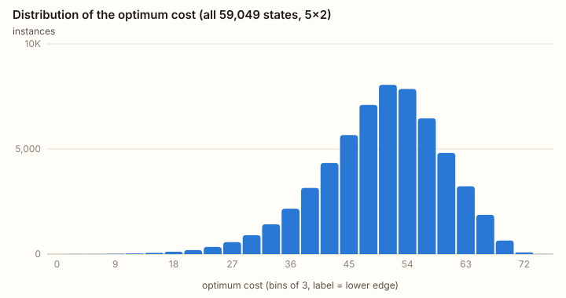
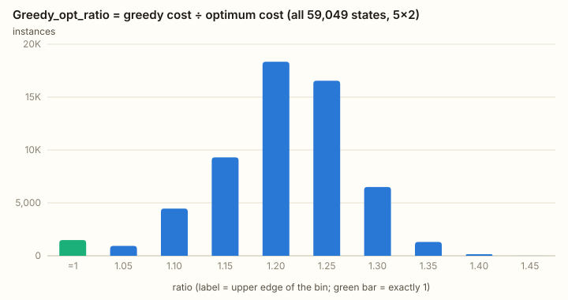
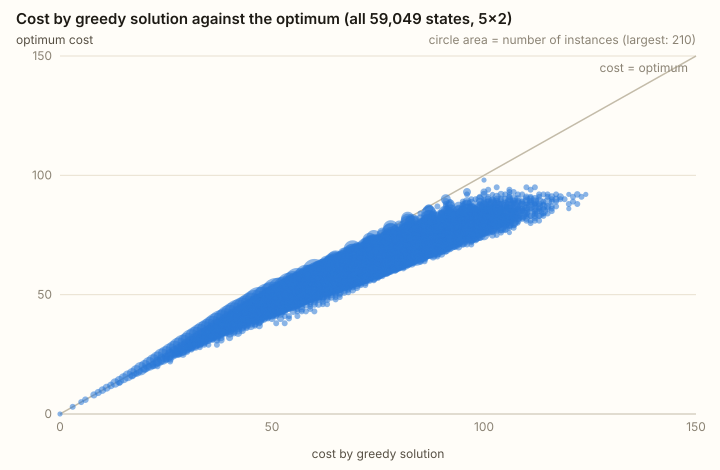
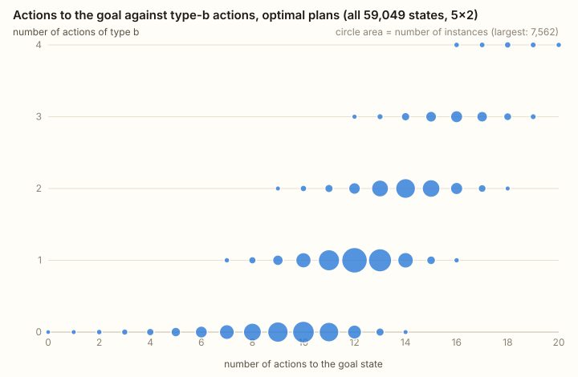
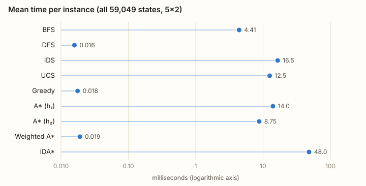
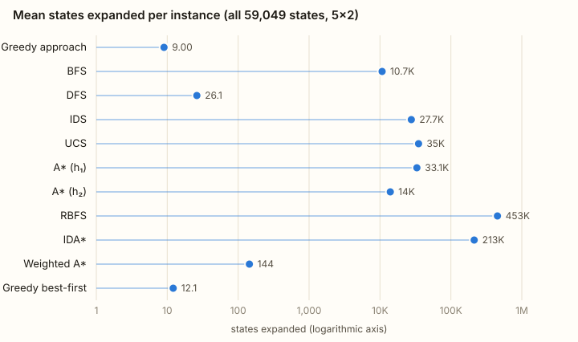
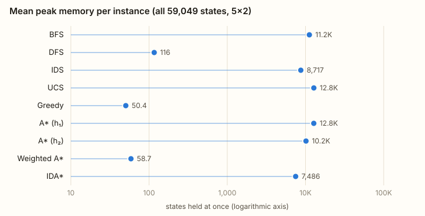
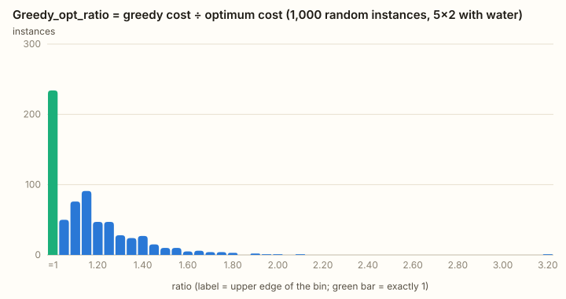

# Sand Boxes — execution report and evaluation of the search algorithms

*(نسخهٔ فارسی: [03-report.fa.md](03-report.fa.md))*

All numbers in this report are read from the JSON files in [`data/`](../data), which are produced
by `npm run analyze`; the figures and tables are generated from the same files by
`node scripts/figures.mjs`. The interactive versions are in the *Analysis* tab of the site.

## 1. What was run

| | |
|---|---|
| Main experiment | **every one of the 3¹⁰ = 59,049 initial states** of the 5×2 sand grid |
| Also | all states of the 2×2, 3×2 and 4×2 grids; 1,000 random 5×2 instances of the water variant |
| Algorithms | BFS, DFS, IDS, UCS, Greedy best-first (h₃), A* (h₁), A* (h₂), Weighted A* (w = 2, h₂), IDA* (h₂) |
| Runs | 9 searches per state: 531,441 searches for the main experiment |
| Machine | Apple M5 (10 logical cores), Node.js 26.10, 4 worker threads |
| Wall time | 1,541 s for the main experiment (6,157 s of search time in total, 46 % of it IDA*) |

Definitions (see [01-problem-original.md](01-problem-original.md) for the model):

- **Door rule.** A door above an opened gate opens by itself only when it is pressed from both
  sides (sand on top of it, a full box under it); all opened doors act at the same moment, and
  `s′` in the cost `1 + 4·(s + s′)` is read after everything has fallen.
- **Greedy** is greedy best-first search guided by the fall-distance heuristic h₃ (5 per unit of
  sand per gate still below it). It is the automatic version of the “flush everything straight
  down” strategy and returns exactly the 47 of the assignment on the worked example.
- **Optimum cost** is computed twice, independently: by dynamic programming over the whole state
  graph (value iteration on the transition table), and by the exact searches (UCS, A*, IDA*).
- **Time** is the wall-clock time of one search, measured with `performance.now()`. Successors and
  heuristic values are precomputed, so the time is pure search effort.
- **Memory** is the peak number of states held at once: the frontier plus the explored set (BFS,
  DFS, UCS, Greedy, A*), or the transposition table plus the recursion stack (IDS, IDA*).
- **Expanded / generated** count states whose successors were produced / successor states produced.

## 2. Correctness checks

| Check | Result |
|---|---|
| Greedy plan of the assignment, 5+5+9+5 and 9+9+5 | 47, every step cost as printed |
| “Other alternative” of the assignment, 1+1, 3+5+9+9+5, 3+5+5 | 46, every step cost as printed |
| Side-gate plan printed as 1+1, 7+9+9+5, 3+5+5 = 45 | not playable as printed; the corrected plan 1+1, 7+9+9+9+5, 3+5+5 costs **54** and matches the state-by-state trace on the 5×2 grid |
| Optimum of the assignment example | **45** with UCS, A* (h₁), A* (h₂) and IDA*, by a different plan (one side gate, on the top row) |
| Exact searches against the dynamic-programming optimum, all 59,049 states × 4 exact algorithms | **0 mismatches** |
| h₁ and h₂ admissible and consistent, every state and every transition of the 1×2 … 5×2 grids | no violation |
| Every returned path replayed through the model ends in a goal state with the reported cost | yes (test-suite) |
| Unsolvable water instance | every algorithm terminates and reports “no solution” |

`npm test` runs these checks (the heuristics on all grids up to 5×2); the comparison of the exact
searches with dynamic programming on all 59,049 states is part of `npm run analyze`, which records
the number of mismatches in the dataset.

## 3. Results on all 59,049 states

### 3.1 Optimal solutions

| Quantity | Mean | Median | 95th percentile | Maximum |
|---|---:|---:|---:|---:|
| Optimum cost | 62.1 | 63 | 81 | 98 |
| Actions in the optimal plan | 11.6 | 12 | — | 20 |



- The most expensive state is **not** the completely full grid (optimum 82: eight flushes at 9 and
  two at 5) but `1 1 / 1 1 / ½ ½ / 1 1 / ½ ½`, with optimum 98: the half boxes break the chain of
  pressed doors, so the piles above them have to be packed by extra actions.
- **64.1 % of all states have an optimal plan that uses at least one side gate.** The share grows
  quickly with the height of the grid (section 4).

| Side gates in the optimal plan | 0 | 1 | 2 | 3 | 4 |
|---|---:|---:|---:|---:|---:|
| States | 21,207 | 23,293 | 11,748 | 2,673 | 128 |
| Share | 35.9 % | 39.4 % | 19.9 % | 4.5 % | 0.2 % |

Where several plans share the optimum cost, the one with the fewest actions is counted, then the
one with the fewest side gates.

### 3.2 Greedy against the optimum — histogram of `Greedy_opt_ratio`

`Greedy_opt_ratio = cost by greedy solution / optimum cost`, over the 59,048 states that contain
sand.



| Ratio | States | Share |
|---|---:|---:|
| exactly 1 (greedy is optimal) | 4,781 | 8.1 % |
| (1.00, 1.05) | 6,711 | 11.4 % |
| [1.05, 1.10) | 10,689 | 18.1 % |
| [1.10, 1.15) | 13,734 | 23.3 % |
| [1.15, 1.20) | 11,125 | 18.8 % |
| [1.20, 1.25) | 7,668 | 13.0 % |
| [1.25, 1.30) | 3,467 | 5.9 % |
| [1.30, 1.35) | 806 | 1.4 % |
| [1.35, 1.40) | 67 | 0.1 % |

Mean 1.128, median 1.125, 95th percentile 1.263, maximum 1.395.

- Greedy is optimal on only 8.1 % of the states and pays on average **12.8 % more** than necessary.
- The worst case is `1 0 / ½ 0 / ½ 0 / 1 0 / ½ 0`: greedy pays 60, the optimum is 43 (ratio 1.40).
- Greedy **never opens a side gate** (0 of 59,049 plans), because a side gate does not reduce the
  fall distance, while 64.1 % of the optimal plans need one.
- The distribution is bell-shaped around 1.13 with a hard upper edge near 1.4: greedy is rarely
  right, but it is never disastrously wrong on sand-only grids.

### 3.3 Scatter plot 1 — greedy cost against optimum cost



Every point lies on or to the right of the diagonal (greedy can never beat the optimum). The cloud
is a narrow band that widens slowly as the optimum grows: the more sand there is, the more
opportunities for a side gate greedy misses, but the overpayment stays proportional (at most 40 %).

### 3.4 Scatter plot 2 — number of actions against number of type-b actions

Optimal plans:



Optimal plans have between 0 and 20 actions, of which 0 to 4 are side gates. Plans with more side
gates are longer — a plan with one side gate has at least 7 actions, one with four at least 16 —
but the relation is loose: there are 14-action plans with no side gate at all. For comparison, the
greedy plans all sit on the horizontal axis
([figure](figures/exhaustive-5x2-actions-vs-sides-greedy.svg)): 12.0 actions on average, none of
type b.

### 3.5 Solution quality of all algorithms

| Algorithm | Heuristic | Optimal on | Mean cost ÷ optimum | Worst cost ÷ optimum | Mean actions |
|---|---|---:|---:|---:|---:|
| BFS | — | 14.3 % | 1.108 | 1.49 | 10.2 |
| DFS | — | 0.1 % | 1.442 | 2.46 | 26.7 |
| IDS | — | 14.3 % | 1.108 | 1.49 | 10.2 |
| UCS | — | **100 %** | 1.000 | 1.00 | 11.7 |
| Greedy | h₃ fall distance | 8.1 % | 1.128 | 1.40 | 12.0 |
| A* | h₁ sand volume | **100 %** | 1.000 | 1.00 | 11.9 |
| A* | h₂ volume + gates | **100 %** | 1.000 | 1.00 | 11.9 |
| Weighted A* (w = 2) | h₂ | 35.7 % | 1.038 | 1.26 | 10.7 |
| IDA* | h₂ | **100 %** | 1.000 | 1.00 | 11.9 |

- BFS and IDS return the same quality (both minimise the number of actions): 10.8 % above the
  optimum, slightly better than greedy's 12.8 %, but with a worse worst case (1.49).
- Weighted A* stays within 3.8 % of the optimum on average and never exceeds 1.26 — far inside its
  guaranteed bound of 2.
- DFS returns whatever it finds first: 27 actions on average, 44 % too expensive.
- The exact algorithms return plans of slightly different lengths (11.7 to 11.9 actions) because
  many states have several optimal plans and each algorithm breaks ties its own way.

### 3.6 Time



| Algorithm | Mean (ms) | Median (ms) | 95th pct (ms) | Max (ms) | Total over 59,049 states (s) |
|---|---:|---:|---:|---:|---:|
| BFS | 4.41 | 2.92 | 13.5 | 71.9 | 260 |
| DFS | 0.016 | 0.016 | 0.024 | 2.74 | 0.93 |
| IDS | 16.5 | 7.60 | 63.2 | 216 | 974 |
| UCS | 12.5 | 7.74 | 38.1 | 97.7 | 740 |
| Greedy | 0.018 | 0.017 | 0.028 | 3.95 | 1.04 |
| A* (h₁) | 14.0 | 9.02 | 42.2 | 146 | 827 |
| A* (h₂) | 8.75 | 5.08 | 28.6 | 99.5 | 517 |
| Weighted A* | 0.019 | 0.016 | 0.042 | 1.91 | 1.12 |
| IDA* | 48.0 | 15.7 | 207 | 790 | 2,836 |

### 3.7 Memory and search effort





| Algorithm | Mean expanded | Median | Max expanded | Mean generated | Mean peak memory (states) | Median | Max peak memory |
|---|---:|---:|---:|---:|---:|---:|---:|
| BFS | 9,363 | 6,797 | 44,032 | 53,500 | 11,200 | 8,282 | 47,402 |
| DFS | 26.7 | 28 | 36 | 115 | 116 | 126 | 177 |
| IDS | 40,200 | 24,900 | 359,540 | 235,000 | 8,717 | 6,229 | 43,103 |
| UCS | 12,791 | 9,446 | 50,034 | 71,500 | 12,800 | 9,447 | 50,035 |
| Greedy | 12.0 | 12 | 24 | 49.4 | 50.4 | 50 | 124 |
| A* (h₁) | 12,664 | 9,340 | 49,882 | 71,000 | 12,800 | 9,442 | 50,023 |
| A* (h₂) | 7,273 | 4,724 | 40,339 | 41,800 | 10,200 | 7,169 | 45,469 |
| Weighted A* | 14.3 | 12 | 138 | 61.0 | 58.7 | 52 | 446 |
| IDA* | 109,701 | 48,200 | 1,420,304 | 635,000 | 7,486 | 4,901 | 40,826 |

No search hit the expansion limit (2,000,000) on any state.

### 3.8 Discussion

- **The problem is “wide”, not deep.** Plans are at most 20 actions long, yet UCS expands 12,800
  states on average — 22 % of the entire state space — and up to 50,034 (85 %). From a full grid
  most states are reachable, and the two columns can be worked on in any interleaving.
- **The quality of the heuristic decides everything.** h₁ (sand volume) is nearly useless here: it
  saves 1 % of the expansions of UCS and, because of its overhead, A* (h₁) is actually *slower*
  than UCS. h₂ (volume + gates) saves 43 % of the expansions and 30 % of the time. The reason is
  what the two see: h₁ only counts the cost of getting sand out through the outlets (mean h/h* of
  0.41), while much of the cost under the pressed-door rule comes from carrying sand down to where
  it can be flushed, which is exactly what the gate term of h₂ measures (mean h/h* of 0.64).
- **Weighted A\* is the clear winner on effort.** With h₂ and w = 2 it expands 14 states on
  average — about as few as greedy — takes 19 microseconds, and returns plans 3.8 % above the
  optimum (worst case 26 %). That is over 400 times faster than A* (h₂) for less than a third of
  greedy's error.
- **IDA\* is the slowest exact algorithm**, 5.5 times slower than A* (h₂), even with a
  transposition table. Step costs take the values 1, 3, 5, 7, 9, so there are many distinct
  f-contours and each iteration repeats most of the previous one: 110,000 expansions against 7,300.
  Its memory advantage is small (7,500 states against 10,200) because the transposition table —
  without which it does not finish at all — is nearly as large as A*'s open and closed lists.
- **IDS shows the same pattern against BFS**: 4.3 times the expansions for 78 % of the memory, and
  it is slower than UCS while being non-optimal in cost.
- **Greedy and DFS are cheap by three orders of magnitude**: they expand about one state per action
  of the plan they return (12 and 27 expansions) and take under 20 microseconds; the price is
  solution quality (13 % and 44 % above the optimum).
- **Fewest actions is not cheapest**: BFS is optimal in cost on only 14 % of the states, because a
  short plan flushes loaded piles (cost 9) where a longer one splits or packs them first.

How the effort grows with the length of the optimal plan (mean states expanded):

| Actions in the optimal plan | 2 | 6 | 10 | 14 | 18 | 20 |
|---|---:|---:|---:|---:|---:|---:|
| States with that length | 14 | 908 | 7,010 | 6,298 | 242 | 10 |
| UCS | 10 | 1,212 | 7,511 | 18,845 | 30,063 | 41,418 |
| A* (h₂) | 2 | 114 | 2,968 | 12,207 | 22,910 | 32,750 |

The interactive line chart in the Analysis tab shows this for every algorithm, for expansions,
memory and time. The advantage of A* over UCS shrinks from a factor of 10 on six-action plans to
2.5 at ten actions and 1.3 on the longest ones, where most of the reachable space must be
examined either way.

## 4. Effect of the grid size

Every state of each grid, same algorithms.

| Grid | States | Mean optimum | Max optimum | Mean plan length | Optimal plans with a side gate | Greedy optimal | Mean greedy ÷ opt | Worst |
|---|---:|---:|---:|---:|---:|---:|---:|---:|
| 2×2 | 81 | 15.3 | 28 | 3.3 | 0 % | 100 % | 1.000 | 1.00 |
| 3×2 | 729 | 29.2 | 52 | 5.8 | 6.0 % | 68.2 % | 1.018 | 1.15 |
| 4×2 | 6,561 | 45.2 | 74 | 8.6 | 37.5 % | 26.6 % | 1.066 | 1.28 |
| 5×2 | 59,049 | 62.1 | 98 | 11.6 | 64.1 % | 8.1 % | 1.128 | 1.40 |

| Grid | BFS expanded | UCS expanded | A* (h₁) expanded | A* (h₂) expanded | Weighted A* expanded | IDA* expanded | UCS time (ms) | A* (h₂) time (ms) |
|---|---:|---:|---:|---:|---:|---:|---:|---:|
| 2×2 | 13 | 27 | 16 | 6 | 3 | 14 | 0.04 | 0.01 |
| 3×2 | 118 | 202 | 181 | 81 | 6 | 402 | 0.11 | 0.05 |
| 4×2 | 1,062 | 1,583 | 1,537 | 824 | 9 | 7,529 | 0.92 | 0.60 |
| 5×2 | 9,363 | 12,791 | 12,664 | 7,273 | 14 | 109,701 | 12.5 | 8.75 |

- On the 2×2 grid side gates never pay off and greedy is always optimal; each extra row makes
  side gates more valuable and greedy worse.
- Each extra row multiplies the state space by 9 and the expansions of UCS and A* by 7 to 14: the
  exact searches grow with the state space itself, and IDA* grows faster (by 15 to 29).
- Weighted A* grows almost linearly with the height of the grid: 3, 6, 9, 14 expansions.
- h₁ helps on small grids (16 against 27 expansions on 2×2) and loses its grip as the grid grows.

## 5. The water variant (proposed form)

1,000 random 5×2 instances (empty 0.40, ½ sand 0.15, full sand 0.20, ½ water 0.10, full water
0.15; seed 1), concrete penalty 10, expansion limit 300,000 per search. The state space has
6¹⁰ ≈ 60 million states, so it is sampled rather than enumerated; the reference optimum of each
instance comes from A*.

| Quantity | Value |
|---|---|
| Solvable instances | 1,000 of 1,000 (11 contain no sand at all) |
| Optimum cost | mean 43.4, median 44, maximum 89 |
| Actions in the optimal plan | mean 7.8, maximum 17 |
| Optimal plans using a side gate | 63.6 % |
| Greedy optimal | 21.1 %; mean ratio 1.194, 95th percentile 1.54, **maximum 3.17** |



| Algorithm | Optimal on | Mean cost ÷ opt | Worst | Mean time (ms) | Max time (ms) | Mean expanded | Mean peak memory | Hit the limit |
|---|---:|---:|---:|---:|---:|---:|---:|---:|
| BFS | 24.4 % | 1.207 | 3.67 | 4.79 | 156 | 3,917 | 6,326 | 0 |
| DFS | 2.3 % | 1.734 | 12.00 | 0.79 | 102 | 887 | 933 | 0 |
| IDS | 24.4 % | 1.208 | 3.67 | 10.6 | 287 | 11,100 | 3,483 | 1 |
| UCS | 98.9 % | 1.000 | 1.00 | 87.1 | 2,057 | 29,400 | 43,200 | 11 |
| Greedy | 21.1 % | 1.194 | 3.17 | 0.51 | 41.2 | 366 | 391 | 0 |
| A* (h₁) | 100 % | 1.000 | 1.00 | 60.9 | 1,425 | 15,000 | 26,400 | 0 |
| A* (h₂) | 100 % | 1.000 | 1.00 | 61.0 | 1,645 | 14,200 | 26,000 | 0 |
| Weighted A* | 68.5 % | 1.024 | 1.29 | 18.0 | 519 | 4,210 | 9,594 | 0 |
| IDA* | 78.5 % | 1.000 | 1.00 | 118 | 709 | 101,000 | 7,966 | 215 |

(For UCS and IDA* “optimal on” counts the instances they finished; every finished run is optimal.)

- **Mistakes get much more expensive.** Without water the worst greedy plan costs 1.40 times the
  optimum; with water 3.17, BFS 3.67 and DFS 12. A careless action creates concrete (+10) and can
  seal a column, after which the remaining sand has to be concreted as well.
- **A\* is the only exact algorithm that finishes every instance** within the limit; it expands
  about half as many states as UCS, which runs out on 11 instances. The reachable space is far
  larger than without water (water moves too), and most of it is much worse than the optimum.
- h₂ falls back to h₁ whenever water is present, which is why the two A* rows nearly coincide and
  why Weighted A* is no longer almost free here (4,210 expansions instead of 14).
- **IDA\* is not viable here**: it exhausts 300,000 expansions on 21.5 % of the instances.
- None of the 1,000 random instances is unsolvable: a random start state contains no concrete,
  and the exact searches can usually avoid creating any. Hand-made cases with concrete in the
  start state, such as `0 0 / ½ 0 / # 0`, are detected by every algorithm (see the tests).

## 6. Conclusions

1. With the cost function `1 + 4·(s + s′)` and doors that open only when pressed from both sides,
   the obvious strategy is rarely the best one: in 64 % of the 5×2 states the optimal plan uses
   side gates, and the straight-down greedy strategy is optimal in only 8 % of them, overpaying by
   13 % on average and up to 40 %.
2. On the assignment's own example the side-gate plan printed as 45 really costs 54 — one action
   of cost 9 is missing — which makes it worse than greedy (47). The optimum is nevertheless 45,
   by a plan that opens only the side gate of the top row.
3. UCS, A* and IDA* agree with the dynamic-programming optimum on all 59,049 states. A* with the
   volume + gates heuristic is the fastest of the three; the weaker volume heuristic gives A* no
   advantage over UCS; IDA* is the slowest and gains little memory, because this state graph is
   wide and full of transpositions.
4. Weighted A* with the strong heuristic gives near-optimal plans (+3.8 %) at the price of greedy
   search: about 14 expansions per instance.
5. Adding water and concrete keeps the model small but makes it harsher: errors become
   irreversible, bad plans cost up to several times the optimum, and informed exact search (A*)
   becomes the only dependable exact method.

## 7. Reproducing the numbers

```bash
npm test
```

```bash
npm run analyze
```

```bash
node scripts/figures.mjs
```

Timings depend on the machine; costs, counts of expanded states and memory figures are
deterministic and should match exactly.
