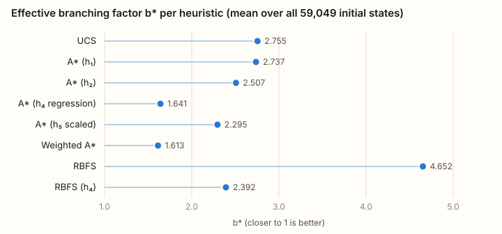
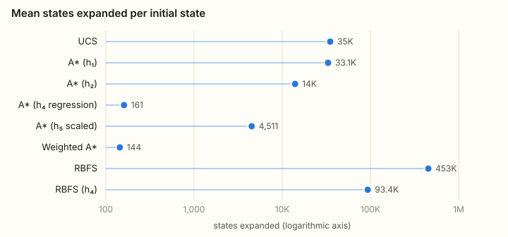
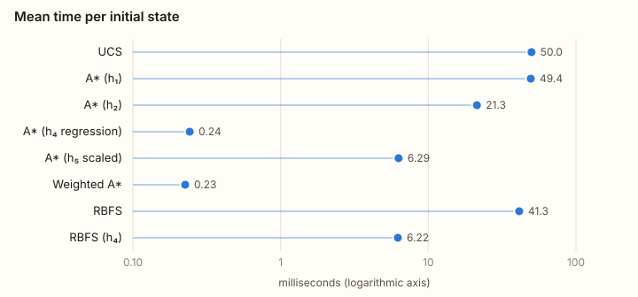
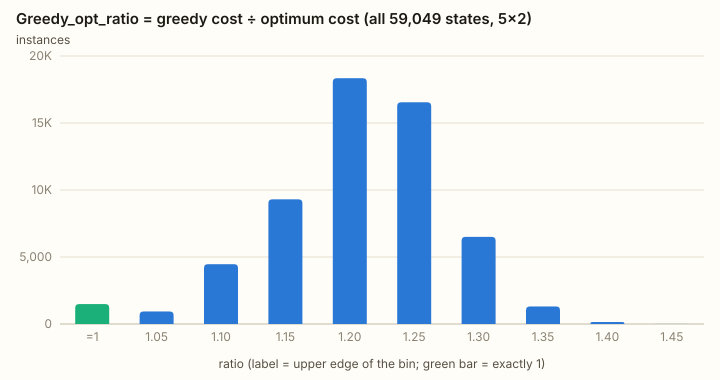
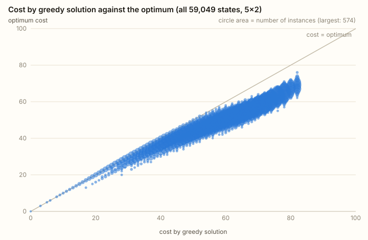
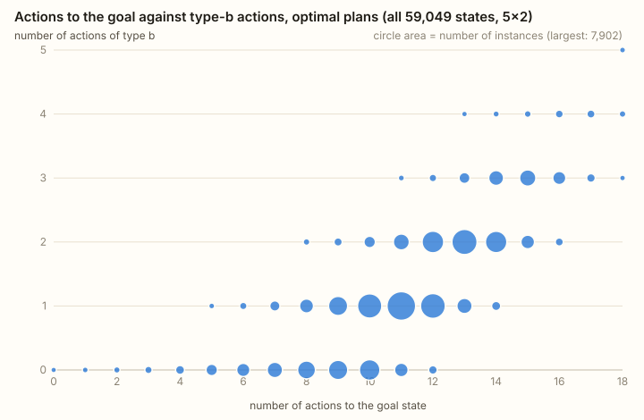

# تکلیف ۲ — گزارش اجرا: هیوریستیک‌ها، ‎A*‎ و RBFS

*(English version, with every table: [a2-report.md](a2-report.md))*

اعداد از ‎`data/a2-5x2.json`‎ (ساخته‌شده با ‎`node scripts/analyze.mjs --only a2-5x2.json`‎) و ‎`data/a2-regression.json`‎ (ساخته‌شده با ‎`npm run learn`‎) خوانده شده‌اند؛ شکل‌ها و جدول‌ها با ‎`node scripts/figures.mjs`‎ از همان‌ها تولید می‌شوند. نسخهٔ تعاملی، زبانهٔ *Evaluation* صفحهٔ تکلیف ۲ است. خودِ هیوریستیک‌ها در [سند طراحی](a2-heuristic-design.fa.md) شرح و اثبات شده‌اند.

## ۱. چه چیزی اجرا شد

| | |
|---|---|
| نمونه‌ها | **همهٔ ۵۹٬۰۴۹ حالت اولیهٔ** جدول ۵×۲ (۳ به توان ۱۰) |
| اجرا برای هر نمونه | ۱۰ اجرا: راهکار حریصانه، BFS، UCS، ‎A*‎ با h₁ و h₂ و h₄ و h₅، ‎A*‎ وزن‌دار (w=2 با h₂)، RBFS با h₂ و با h₄ |
| بهینهٔ مرجع | تکرار مقدار روی کل گراف حالتِ دسترس‌پذیر (۳۲۶٬۰۴۱ حالت)، با UCS و ‎A*‎ روی هر نمونه مقایسه شده: **صفر مغایرت** |
| سقف‌ها | ۲٬۰۰۰٬۰۰۰ بسط برای هر اجرا؛ RBFS ۵۰۰٬۰۰۰ |
| ماشین | Apple M5 (۱۰ هستهٔ منطقی)، Node.js 26.10، شش نخ کارگر؛ ۱۷۹۹ ثانیه زمان دیواری، ۱۰٬۷۴۰ ثانیه جستجو |

**ضریب انشعاب مؤثر:** برای اجرایی که N حالت تولید و برنامه‌ای با d کنش برگردانده، ‎b*‎ ریشهٔ ‎`1 + b + b² + … + b^d = N + 1`‎ است؛ برای هر نمونه محاسبه و میانگین گرفته می‌شود.

**هیوریستیک‌ها** (جزئیات و اثبات‌ها در سند طراحی):

| | تعریف | وضعیت |
|---|---|---|
| h₀ | ۰ | UCS |
| h₁ | ۳ برای هر ستونِ شن‌دار | قابل‌قبول و سازگار (اثبات‌شده) |
| h₂ | ۳ برای هر دریچهٔ بستهٔ با شن بالایش | قابل‌قبول و سازگار (اثبات‌شده) |
| h₄ | رگرسیون خطیِ ‎h*‎ روی ۱۳ ویژگی حالت | برآورد؛ در ۴۸٫۶٪ حالت‌ها بیش‌برآورد |
| h₅ | ‎max(h₂, h₄ − 11.76)‎ | در همهٔ حالت‌های آموزش ‎≤ h*‎؛ اثبات‌نشده |

## ۲. نتایج روی هر ۵۹٬۰۴۹ حالت

### ۲٫۱ ضریب انشعاب مؤثر

| اجرا | میانگین ‎b*‎ | میانهٔ ‎b*‎ | صدک ۹۵ | تمام‌شده | بهینه در |
|---|---:|---:|---:|---:|---:|
| UCS (h₀) | 2.755 | 2.613 | 3.852 | 59,049 | 100% |
| ‎A* (h₁)‎ | 2.737 | 2.602 | 3.811 | 59,049 | 100% |
| ‎A* (h₂)‎ | 2.507 | 2.427 | 3.316 | 59,049 | 100% |
| **‎A* (h₄ رگرسیون)‎** | **1.641** | 1.621 | 1.974 | 59,049 | 84.0% |
| **‎A* (h₅ امن‌شده)‎** | **2.295** | 2.238 | 2.905 | 59,049 | **100%** |
| ‎A*‎ وزن‌دار (h₂) | 1.613 | 1.585 | 1.989 | 59,049 | 44.7% |
| RBFS (h₂) | 4.652 | 4.277 | 7.679 | 7,227 (۱۲٫۲٪) | همهٔ تمام‌شده‌ها |
| RBFS (h₄) | 2.392 | 2.349 | 3.625 | 52,803 (۸۹٫۴٪) | 72.8% |
| BFS | 3.057 | 3.098 | 3.547 | 59,049 | 2.5% |
| راهکار حریصانه | 1.333 | 1.328 | 1.429 | 59,049 | 2.5% |

(برای RBFS ‎b*‎ روی نمونه‌هایی است که در سقف تمام کرده است.)

### ۲٫۲ تلاش و کیفیت برنامه

| اجرا | بهینه در | میانگین هزینه ÷ بهینه | بدترین | میانگین بسط | میانگین تولید | میانگین حافظه | میانگین زمان (ms) | رسیدن به سقف |
|---|---:|---:|---:|---:|---:|---:|---:|---:|
| UCS (h₀) | 100% | 1.000 | 1.00 | 34,994 | 223,894 | 35,311 | 50.0 | 0 |
| ‎A* (h₁)‎ | 100% | 1.000 | 1.00 | 33,132 | 214,661 | 34,880 | 49.4 | 0 |
| ‎A* (h₂)‎ | 100% | 1.000 | 1.00 | 13,976 | 95,430 | 22,215 | 21.3 | 0 |
| ‎A* (h₄)‎ | 84.0% | 1.004 | 1.13 | **161** | 1,045 | 699 | **0.24** | 0 |
| ‎A* (h₅)‎ | **100%** | 1.000 | 1.00 | **4,511** | 29,196 | 10,437 | 6.29 | 0 |
| ‎A*‎ وزن‌دار (h₂) | 44.7% | 1.033 | 1.25 | 144 | 924 | 572 | 0.23 | 0 |
| RBFS (h₂) | ۱۲٫۲٪ تمام‌شده | 1.000 | 1.00 | 453,344 | 2,948,629 | 95 | 41.3 | 51,822 |
| RBFS (h₄) | 72.8% | 1.007 | 1.21 | 93,352 | 540,342 | 76 | 6.22 | 6,246 |

رشد تلاش با طول برنامهٔ بهینه (میانگین حالت‌های بسط‌یافته):

| تعداد کنش‌های برنامهٔ بهینه | ۴ | ۶ | ۸ | ۱۰ | ۱۲ | ۱۴ | ۱۶ | ۱۸ |
|---|---:|---:|---:|---:|---:|---:|---:|---:|
| UCS | 225 | 2,103 | 7,715 | 33,181 | 39,053 | 50,379 | 64,669 | 63,881 |
| ‎A* (h₂)‎ | 39 | 310 | 2,007 | 10,831 | 15,480 | 23,568 | 33,668 | 35,982 |
| ‎A* (h₅)‎ | 37 | 206 | 1,002 | 3,239 | 5,008 | 7,747 | 11,148 | 12,695 |
| ‎A* (h₄)‎ | 7 | 20 | 54 | 113 | 179 | 265 | 422 | 703 |

### ۲٫۳ خوانش اعداد

- **هیوریستیک اثبات‌شدهٔ h₂ کمک می‌کند، ولی تا حدی.** نسبت به UCS ۶۰٪ از بسط‌ها و ۵۷٪ از زمان را کم می‌کند و ‎b*‎ را از ۲٫۷۵ به ۲٫۵۱ می‌رساند. h₁ تقریباً بی‌فایده است (‎b*‎ ۲٫۷۴، ۵٪ بسط کمتر، بدون صرفه‌جویی زمان). هر دو در مقیاس مطلق ضعیف‌اند (میانگین ‎h/h*‎ برابر ۰٫۱۲ و ۰٫۵۴).
- **h₄ یادگرفته‌شده در لیگی دیگر است و قابل‌قبول نیست.** ‎A*‎ با h₄ به‌طور میانگین ۱۶۱ حالت بسط می‌دهد، ۸۷ برابر کمتر از h₂، با ‎b*‎ ۱٫۶۴ و در یک‌چهارم میلی‌ثانیه. بهایش: در ۱۶٪ حالت‌ها برنامهٔ نابهینه برمی‌گرداند، به‌طور میانگین ۰٫۴٪ و حداکثر ۱۳٪ گران‌تر (برنامه‌ای با هزینهٔ ۷۰ برای بهینهٔ ۶۲). این معاملهٔ بهتری است از ‎A*‎ وزن‌دار با h₂ که همان‌قدر سریع است ولی در ۵۵٪ حالت‌ها نابهینه و حداکثر ۲۵٪ گران‌تر است.
- **h₅ بهینگی را پس می‌گیرد.** پایین آوردن h₄ به اندازهٔ بدترین بیش‌برآوردش و کف گذاشتن با h₂، هیوریستیکی می‌دهد که هنوز ۳٫۱ برابر مؤثرتر از h₂ است (۴٬۵۱۱ بسط در برابر ۱۳٬۹۷۶، ‎b*‎ ۲٫۳۰ در برابر ۲٫۵۱) و روی هر ۵۹٬۰۴۹ حالت بهینه بود. چون همهٔ حالت‌های اولیه در مجموعهٔ آموزش‌اند این انتظار می‌رفت؛ پرسش باز، حالت‌های دیده‌نشده‌اند و آزمایش انتقال ۴×۲ به ۵×۲ در سند طراحی نشان می‌دهد که جابه‌جایی δ باید برای آن‌ها دوباره برآورد شود.
- **تلاش جستجوهای دقیق تقریباً هم‌پای فضای حالت با طول برنامه رشد می‌کند:** UCS برای برنامه‌های ۱۸کنشی ۶۴٬۰۰۰ بسط لازم دارد، ‎A* (h₂)‎ ۳۶٬۰۰۰، ‎A* (h₅)‎ ۱۲٬۷۰۰ و ‎A* (h₄)‎ ۷۰۰. برتری هیوریستیک یادگرفته‌شده با سختی نمونه *بیشتر* می‌شود.
- **RBFS به هیوریستیک زنده است.** با h₂ در سقف ۵۰۰٬۰۰۰ بسط فقط ۱۲٪ حالت‌ها را تمام می‌کند (‎b*‎ ۴٫۶۵ روی آن‌ها)؛ با h₄ ۸۹٪ را، با ۷۶ حالت حافظه، ‎b*‎ ۲٫۳۹ و برنامهٔ بهینه در ۷۳٪ حالت‌ها. جستجوی با حافظهٔ خطی در این گراف به هیوریستیکی تیز نیاز دارد، چون هر جابه‌جایی بین دو ستون دوباره پرداخت می‌شود.
- **حافظه هم از هیوریستیک پیروی می‌کند:** ‎A*‎ با h₀ ۳۵٬۰۰۰ حالت، با h₂ ۲۲٬۰۰۰، با h₅ ۱۰٬۰۰۰ و با h₄ ۷۰۰ حالت نگه می‌دارد.

### ۲٫۴ هیستوگرام ‎`Greedy_opt_ratio`‎

راهکار حریصانهٔ تکلیف (پیمایش مستقیم هر ستون، بدون دریچهٔ کناری)، ‎`Greedy_opt_ratio = cost by greedy solution / optimum cost`‎ روی ۵۹٬۰۴۸ حالت شن‌دار:

| نسبت | تعداد حالت | سهم |
|---|---:|---:|
| دقیقاً ۱ | 1,488 | 2.5% |
| ‎(1.00, 1.05)‎ | 934 | 1.6% |
| ‎[1.05, 1.10)‎ | 4,464 | 7.6% |
| ‎[1.10, 1.15)‎ | 9,304 | 15.8% |
| ‎[1.15, 1.20)‎ | 18,342 | 31.1% |
| ‎[1.20, 1.25)‎ | 16,546 | 28.0% |
| ‎[1.25, 1.30)‎ | 6,504 | 11.0% |
| ‎[1.30, 1.35)‎ | 1,310 | 2.2% |
| ‎[1.35, 1.40)‎ | 149 | 0.3% |
| ‎[1.40, 1.45)‎ | 7 | 0.01% |

میانگین ۱٫۱۸۰، میانه ۱٫۱۸۶، صدک ۹۵ برابر ۱٫۲۷۹، بیشینه ۱٫۴۱۳. راهکار حریصانه در ۲٫۵٪ حالت‌ها بهینه و به‌طور میانگین ۱۸٪ گران‌تر است؛ با یک واحد برای هر دریچه روی همهٔ حالت‌ها بهینه است (آزموده شده)، پس کل فاصله ساختهٔ تابع هزینه است.

### ۲٫۵ نمودارهای پراکندگی

همهٔ نقطه‌ها روی قطر یا سمت راست آن‌اند؛ نوار باریک و تقریباً متناسب است (برای تقریباً همهٔ حالت‌ها ۵٪ تا ۳۰٪ گران‌تر).

برنامه‌های بهینه ۰ تا ۱۸ کنش دارند که ۰ تا ۵ تای آن‌ها دریچهٔ کناری است؛ ۷۸٪ دست‌کم یکی دارند. برنامه‌های راهکار حریصانه (بدون نوع b، میانگین ۹٫۰ کنش) همه روی محور افقی‌اند؛ برنامه‌های بهینه طولانی‌ترند (میانگین ۱۱٫۲) چون کنش‌های ارزان خرج می‌کنند تا از کنش‌های گران دوری کنند.

## ۳. جمع‌بندی

۱. **هیوریستیکِ طراحی‌شده با واهلش امن و فروتن است.** h₂ قابل‌قبول و سازگار است (اثبات‌شده و روی همهٔ حالت‌های دسترس‌پذیر آزموده‌شده)؛ کار ‎A*‎ را ۶۰٪ کم می‌کند و ‎b*‎ را از ۲٫۷۵ به ۲٫۵۱ می‌رساند. ضعفش ساختاری است: واهلش فقط تعداد دریچه‌های بسته را نگه می‌دارد، در حالی که هزینهٔ این مسأله در این است که دریچه‌ها هنگام باز شدن *چقدر بار دارند*.

۲. **هیوریستیکِ یادگرفته‌شده با رگرسیون خطی تیز و ناامن است.** h₄ به ‎A*‎ ‎b*‎ برابر ۱٫۶۴ و صرفه‌جویی صدبرابری در تلاش می‌دهد، به بهای برنامه‌های نابهینه در ۱۶٪ حالت‌ها (هرگز بیش از ۱۳٪ گران‌تر). RBFS را هم عملی می‌کند (۸۹٪ تمام‌شده در سقف، با کمتر از ۱۵۰ حالت حافظه).

۳. **ترکیب این دو بهترین جستجوی دقیق ماست.** ‎h₅ = max(h₂, h₄ − δ)‎ روی هر ۵۹٬۰۴۹ حالت بهینه بود و سه برابر مؤثرتر از h₂. تضمینش روی حالت‌های آموزش به‌ساخت برقرار است؛ بیرون از آن‌ها ادعایی تجربی است.

۴. **‎b*‎ عدد مناسبی برای خلاصه کردن یک هیوریستیک است:** هیوریستیک‌ها را دقیقاً به ترتیب تلاش مرتب می‌کند (‎h₀ 2.75 > h₁ 2.74 > h₂ 2.51 > h₅ 2.30 > h₄ 1.64‎) و برخلاف تعداد خام بسط‌ها، بین نمونه‌هایی با عمق متفاوت قابل مقایسه است.

۵. راهکار حریصانه، دوباره با قاعده‌های نهایی: در ۲٫۵٪ حالت‌ها بهینه، به‌طور میانگین ۱۸٪ و حداکثر ۴۱٪ گران‌تر، و با هزینهٔ واحد همه‌جا بهینه.

