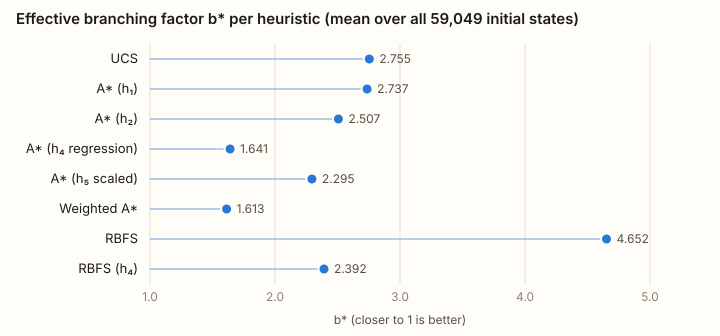
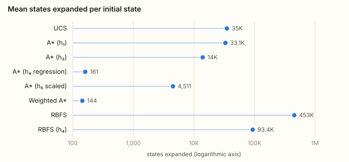
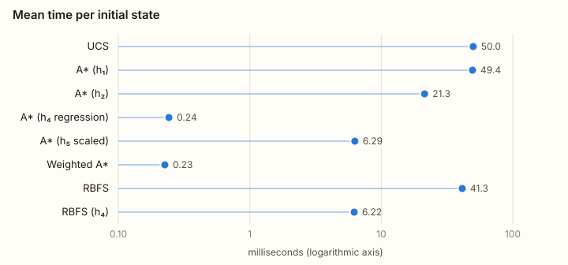
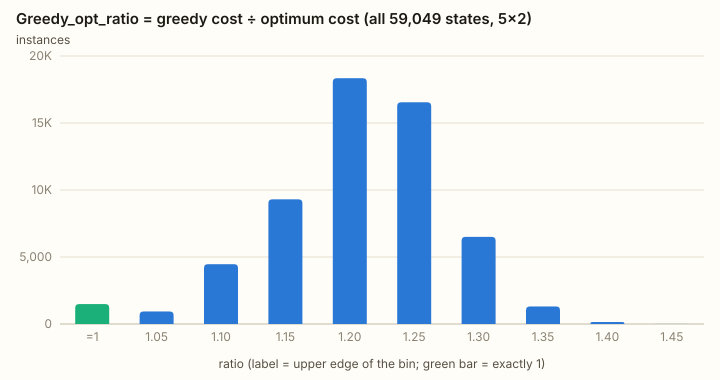
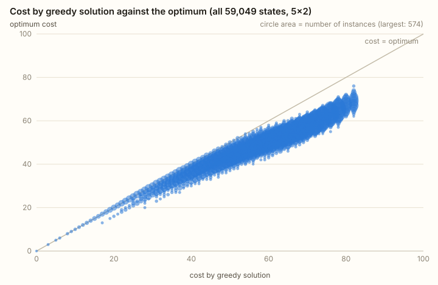
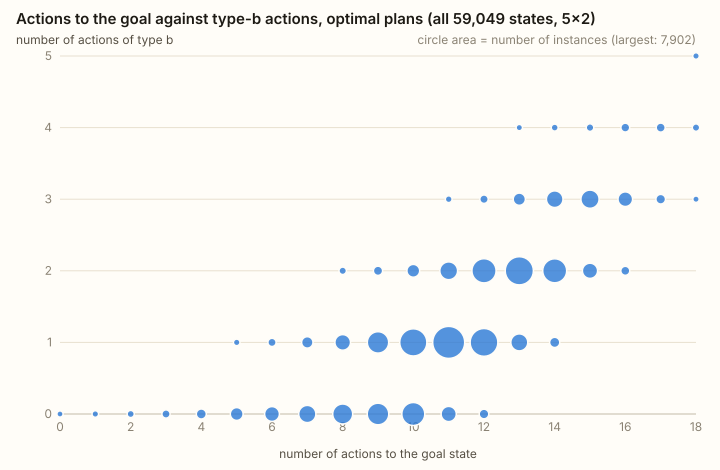

# Assignment 2 — execution report: heuristics, A* and RBFS

*(نسخهٔ فارسی: [a2-report.fa.md](a2-report.fa.md))*

Numbers come from `data/a2-5x2.json` (written by `node scripts/analyze.mjs --only a2-5x2.json`) and
`data/a2-regression.json` (written by `npm run learn`); figures and tables are produced from them by
`node scripts/figures.mjs`. The interactive version is the *Evaluation* tab of the Assignment 2
page. The heuristics themselves are described and proved in
[a2-heuristic-design.md](a2-heuristic-design.md).

## 1. What was run

| | |
|---|---|
| Instances | **every one of the 3¹⁰ = 59,049 initial states** of the 5×2 grid |
| Runs per instance | 10: the greedy approach, BFS, UCS, A* with h₁, h₂, h₄ and h₅, Weighted A* (w = 2, h₂), RBFS with h₂ and with h₄ |
| Reference optimum | value iteration over the whole reachable state graph (326,041 states), checked against UCS and A* on every instance: **0 mismatches** |
| Budgets | 2,000,000 expansions per run; RBFS 500,000 |
| Machine | Apple M5 (10 logical cores), Node.js 26.10, 6 worker threads; 1,799 s wall, 10,740 s of search |

**Effective branching factor.** For a run that generates *N* states and returns a plan of *d*
actions, b* solves `1 + b + b² + … + b^d = N + 1`. It is computed per instance and averaged.

**The heuristics** (details and proofs in the design document):

| | Definition | Status |
|---|---|---|
| h₀ | 0 | UCS |
| h₁ | 3 per column that holds sand | proven admissible and consistent |
| h₂ | 3 per closed gate with sand above it | proven admissible and consistent |
| h₄ | linear regression of h* on 13 state features | estimate; overestimates 48.6 % of states |
| h₅ | max(h₂, h₄ − 11.76) | ≤ h* on every training state; not proven |

## 2. Results on all 59,049 states

### 2.1 Effective branching factor



| Run | Mean b* | Median b* | 95th pct b* | Finished | Optimal on |
|---|---:|---:|---:|---:|---:|
| UCS (h₀) | 2.755 | 2.613 | 3.852 | 59,049 | 100 % |
| A* (h₁) | 2.737 | 2.602 | 3.811 | 59,049 | 100 % |
| A* (h₂) | 2.507 | 2.427 | 3.316 | 59,049 | 100 % |
| **A* (h₄ regression)** | **1.641** | 1.621 | 1.974 | 59,049 | 84.0 % |
| **A* (h₅ made safe)** | **2.295** | 2.238 | 2.905 | 59,049 | **100 %** |
| Weighted A* (h₂, w = 2) | 1.613 | 1.585 | 1.989 | 59,049 | 44.7 % |
| RBFS (h₂) | 4.652 | 4.277 | 7.679 | 7,227 (12.2 %) | all finished |
| RBFS (h₄) | 2.392 | 2.349 | 3.625 | 52,803 (89.4 %) | 72.8 % |
| BFS | 3.057 | 3.098 | 3.547 | 59,049 | 2.5 % |
| Greedy approach | 1.333 | 1.328 | 1.429 | 59,049 | 2.5 % |

(For the greedy approach and BFS b* is computed the same way from the states they generate; BFS
stops at the shortest plan, so its *d* is smaller than the optimal plan's, which inflates its b*.
RBFS's b* is over the instances it finished within its budget.)

### 2.2 Effort and plan quality



| Run | Optimal on | Mean cost ÷ opt | Worst | Mean expanded | Mean generated | Mean peak memory | Mean time (ms) | Hit the budget |
|---|---:|---:|---:|---:|---:|---:|---:|---:|
| UCS (h₀) | 100 % | 1.000 | 1.00 | 34,994 | 223,894 | 35,311 | 50.0 | 0 |
| A* (h₁) | 100 % | 1.000 | 1.00 | 33,132 | 214,661 | 34,880 | 49.4 | 0 |
| A* (h₂) | 100 % | 1.000 | 1.00 | 13,976 | 95,430 | 22,215 | 21.3 | 0 |
| A* (h₄) | 84.0 % | 1.004 | 1.13 | **161** | 1,045 | 699 | **0.24** | 0 |
| A* (h₅) | **100 %** | 1.000 | 1.00 | **4,511** | 29,196 | 10,437 | 6.29 | 0 |
| Weighted A* (h₂) | 44.7 % | 1.033 | 1.25 | 144 | 924 | 572 | 0.23 | 0 |
| RBFS (h₂) | 12.2 % finished | 1.000 | 1.00 | 453,344 | 2,948,629 | 95 | 41.3 | 51,822 |
| RBFS (h₄) | 72.8 % | 1.007 | 1.21 | 93,352 | 540,342 | 76 | 6.22 | 6,246 |



How the effort grows with the length of the optimal plan (mean states expanded):

| Actions in the optimal plan | 4 | 6 | 8 | 10 | 12 | 14 | 16 | 18 |
|---|---:|---:|---:|---:|---:|---:|---:|---:|
| UCS | 225 | 2,103 | 7,715 | 33,181 | 39,053 | 50,379 | 64,669 | 63,881 |
| A* (h₂) | 39 | 310 | 2,007 | 10,831 | 15,480 | 23,568 | 33,668 | 35,982 |
| A* (h₅) | 37 | 206 | 1,002 | 3,239 | 5,008 | 7,747 | 11,148 | 12,695 |
| A* (h₄) | 7 | 20 | 54 | 113 | 179 | 265 | 422 | 703 |

### 2.3 Reading the numbers

- **The proven heuristic h₂ helps, but only so much.** Against UCS it removes 60 % of the
  expansions and 57 % of the time and brings b* from 2.75 to 2.51. h₁ is almost useless (b* 2.74,
  5 % fewer expansions, no time saved). Both are weak in absolute terms (mean h/h* 0.12 and 0.54).
- **The learned h₄ is in a different league — and not admissible.** A* with h₄ expands 161 states
  on average, 87 times fewer than with h₂, with b* 1.64, in a quarter of a millisecond. The price:
  it returns a non-optimal plan on 16 % of the states, by 0.4 % on average and 13 % at worst (a
  plan of 70 for an optimum of 62). That is a better trade than Weighted A* with h₂, which is just
  as fast but non-optimal on 55 % of the states and 25 % over at worst.
- **h₅ recovers optimality.** Shifting h₄ down by its worst overestimate and flooring it with h₂
  gives a heuristic that is still 3.1 times more effective than h₂ (4,511 expansions against
  13,976, b* 2.30 against 2.51) and was optimal on all 59,049 states. Since every initial state is
  a training state this is expected; the open question is unseen states, and the 4×2 → 5×2
  transfer in the design document shows that the shift would have to be re-estimated for them.
- **The effort of the exact searches grows with the length of the plan** roughly as the state
  space does: UCS needs 64,000 expansions for 18-action plans, A* (h₂) 36,000, A* (h₅) 12,700 —
  and A* (h₄) 700. The learned heuristic's advantage *grows* with the difficulty of the instance.
- **RBFS lives or dies by the heuristic.** With h₂ it finishes 12 % of the states within 500,000
  expansions (b* 4.65 on those); with h₄ it finishes 89 %, with 76 states of memory, b* 2.39, and
  optimal plans on 73 % of the states. A linear-memory search needs a sharp heuristic on this
  graph, because every transposition between the two columns is paid for again.
- **Memory follows the heuristic too**: A* holds 35,000 states with h₀, 22,000 with h₂, 10,000
  with h₅ and 700 with h₄.

### 2.4 Histogram of `Greedy_opt_ratio`

The greedy approach of the assignment (straight-down sweep of each column, no side gates),
`Greedy_opt_ratio = cost by greedy solution / optimum cost`, over the 59,048 states with sand:



| Ratio | States | Share |
|---|---:|---:|
| exactly 1 | 1,488 | 2.5 % |
| (1.00, 1.05) | 934 | 1.6 % |
| [1.05, 1.10) | 4,464 | 7.6 % |
| [1.10, 1.15) | 9,304 | 15.8 % |
| [1.15, 1.20) | 18,342 | 31.1 % |
| [1.20, 1.25) | 16,546 | 28.0 % |
| [1.25, 1.30) | 6,504 | 11.0 % |
| [1.30, 1.35) | 1,310 | 2.2 % |
| [1.35, 1.40) | 149 | 0.3 % |
| [1.40, 1.45) | 7 | 0.01 % |

Mean 1.180, median 1.186, 95th percentile 1.279, maximum 1.413. The greedy approach is optimal on
2.5 % of the states and 18 % too expensive on average; with one unit per gate it is optimal on all
of them (checked), so the whole gap is created by the cost function.

### 2.5 Scatter plots



Every point is on or to the right of the diagonal; the band is narrow and roughly proportional
(5 % to 30 % over for almost every state).



Optimal plans have 0 to 18 actions, 0 to 5 of them side gates; 78 % use at least one. The greedy
approach's plans (none of type b, 9.0 actions on average) all lie on the horizontal axis; optimal
plans are longer (11.2 on average) because they spend cheap actions to avoid expensive ones.

## 3. Conclusions

1. **A heuristic designed by relaxation is safe and modest.** h₂ is proven admissible and
   consistent (and checked on every reachable state); it cuts A*'s work by 60 % and brings b* from
   2.75 to 2.51. Its weakness is structural: the relaxation keeps only the number of closed gates,
   and the cost of this problem lives in *how loaded* the gates are when they are opened.
2. **A heuristic learned by linear regression is sharp and unsafe.** h₄ gives A* a b* of 1.64 and
   a hundredfold saving in effort, at the price of sub-optimal plans on 16 % of the states (never
   more than 13 % over). It also makes RBFS practical (89 % finished within budget, in under 150
   states of memory).
3. **Combining the two gives the best exact search we have.** h₅ = max(h₂, h₄ − δ) was optimal on
   every one of the 59,049 states and three times more effective than h₂. Its guarantee holds on
   the training states by construction; outside them it is an empirical claim.
4. **b* is the right single number for a heuristic.** It orders the heuristics exactly as the
   effort does (h₀ 2.75 > h₁ 2.74 > h₂ 2.51 > h₅ 2.30 > h₄ 1.64) and, unlike raw expansions, it
   can be compared across instances of different depth.
5. The greedy approach, measured again under the final rules: optimal on 2.5 % of the states,
   18 % over on average, never more than 41 % — and optimal everywhere under unit costs.

## 4. Reproducing the numbers

```bash
npm test
```

```bash
npm run learn
```

```bash
node scripts/analyze.mjs --only a2-5x2.json
```

```bash
node scripts/figures.mjs
```

Costs, counts and b* are deterministic; times depend on the machine.
