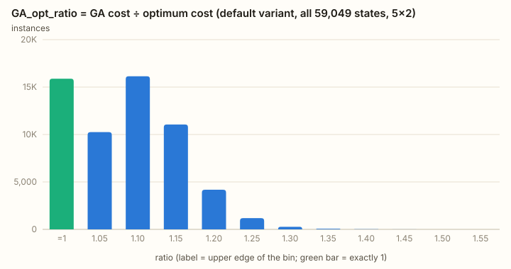
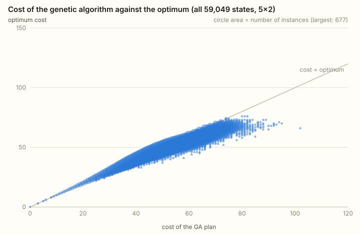

# تمرین سوم — گزارش اجرا و ارزیابی: الگوریتم ژنتیک در برابر A* و UCS

ماده‌ی ۶ تحویل می‌خواهد کارایی الگوریتم ژنتیک در برابر دست‌کم یکی از الگوریتم‌های جست‌وجوی فضای حالت گزارش شود: تعداد موفقیت‌ها روی ۱۰۰ مسئله‌ی تصادفی با حالت‌های اولیه‌ی متفاوت، درصد موفقیت‌هایی که path_cost بهینه دارند (برابر با A\* / UCS)، و میانگین `GA_Path_cost / optimum_path_cost` یک بار روی کل ۱۰۰ مسئله و یک بار فقط روی موفقیت‌ها. بخش ۱ دقیقاً همین را می‌دهد، برای پیکربندی پیش‌فرض و برای هر گزینه‌ی دیگری که در [a3-genetic-design.fa.md](a3-genetic-design.fa.md) شرح داده شده، روی شبکه‌ی ۵×۲ و ۶×۲. بخش ۲ اجرای بزرگ‌تری روی همه‌ی ۵۹٬۰۴۹ استیت اولیه‌ی شبکه‌ی ۵×۲ را می‌افزاید که با نسخه‌ی اول الگوریتم انجام شده است. اعداد خام در `data/a3-random100.json` و `data/a3-5x2.json` هستند؛ [برگه‌ی Evaluation](https://soyapo.github.io/sand-boxes/assignment-3/#eval) هر دو را رسم می‌کند.

## ۱. ۱۰۰ مسئله‌ی تصادفی، GA در برابر A\* و UCS

### ۱٫۱ چیدمان

| | |
|---|---|
| مسائل | ۱۰۰ استیت اولیه‌ی تصادفی متمایز به ازای هر اندازه‌ی شبکه، با احتمال‌های تمرین (خالی ۰٫۵، پر ۰٫۳، نیمه ۰٫۲)، بذر ۱؛ شبکه‌ی ۵×۲ و شبکه‌ی سخت‌تر ۶×۲ |
| مرجع | A\* با h₂ و جست‌وجوی هزینه‌ی یکنواخت روی هر مسئله؛ روی هر بهینه توافق دارند |
| GA | یک اجرا به ازای هر مسئله و پیکربندی، بذر ۱ ترکیب‌شده با استیت اولیه؛ پیکربندی پیش‌فرض و ۱۲ گزینه که هر یک یک چیز را عوض می‌کند |
| پیش‌فرض‌ها | جمعیت ۶۰، حداکثر ۱۵۰ نسل، توقف پس از ۵۰ نسل بدون بهبود، کران طول ۴ به ازای هر ردیف (۲۰ و ۲۴)، نخبه ۲، ترکیب ۰٫۹، جهش ۰٫۳، رولت روی f − f_min، شایستگی `L − 9·gates − cost`، عدد تعارض = کمترین در طول دنباله، هر شش جهش، ترکیب تک‌نقطه‌ای، ترمیم |
| قرارداد | وقتی GA به هدف نمی‌رسد، `GA_Path_cost` هزینه‌ی مسیرِ شایسته‌ترین دنباله‌ی برگشتی است: مسیری ناتمام، پس ارزان (و در پیکربندی «غیرمجاز با شایستگی ۰» دنباله‌ای غیرمجاز و دلخواه که هزینه‌اش هزینه‌ی پیشوند مجازش است). به همین دلیل میانگین کل مسائل برای پیکربندی ناموفق *زیر* ۱ می‌افتد؛ ردیف‌های مسئله‌به‌مسئله دو عدد را از هم جدا نگه می‌دارند |
| نویز | یک بذر به ازای هر مسئله؛ تفاوت چهار پنج مسئله در ۱۰۰ میان دو پیکربندی در حد چیزی است که بذر دیگری عوض می‌کند، پس فقط فاصله‌های بزرگ‌ترِ زیر به عنوان تفاوت خوانده می‌شوند |
| ماشین | Apple M5، Node.js 26، یک نخ؛ ۴۴ ثانیه برای مجموعه‌ی ۵×۲، ۲۳۳ ثانیه برای ۶×۲ (A\* و UCS در دومی غالب‌اند) |

`node scripts/evaluate-ga.mjs` هر دو مجموعه را بازتولید می‌کند.

### ۱٫۲ چهار عدد خواسته‌شده، پیکربندی پیش‌فرض

<!-- gen:headline -->
| | ۵×۲ | ۶×۲ |
|---|---:|---:|
| مسائل | ۱۰۰ | ۱۰۰ |
| میانگین هزینه‌ی بهینه (بیشینه) | ۴۳٫۶ (۶۹) | ۵۷٫۵ (۸۱) |
| میانگین طول برنامه‌ی بهینه (بیشینه) | ۹٫۹ عمل (۱۵) | ۱۲٫۷ عمل (۲۰) |
| **موفقیت‌های GA (رسیدن به هدف)** | **۱۰۰ / ۱۰۰** | **۱۰۰ / ۱۰۰** |
| **موفقیت‌هایی با هزینه‌ی مسیر بهینه** | **۴۸ (۴۸٪)** | **۲۵ (۲۵٪)** |
| **میانگین GA_Path_cost ÷ بهینه، هر ۱۰۰ مسئله** | **۱٫۰۴۱** | **۱٫۰۷۵** |
| **میانگین نسبت، فقط موفقیت‌ها** | **۱٫۰۴۱** | **۱٫۰۷۵** |
| بدترین نسبت | ۱٫۲۴ | ۱٫۳۶ |
| میانگین اضافه‌ی راه‌حل‌های غیربهینه | ۷٫۹٪ | ۱۰٫۱٪ |
| میانگین ارزیابی شایستگی | ۵٬۲۸۳ | ۶٬۳۲۶ |
| میانگین نسل‌های اجراشده | ۶۹٫۲ | ۸۳٫۰ |
| میانه‌ی زمان هر مسئله | ۲۴٫۵ ms | ۴۶٫۷ ms |
| A\*: میانگین استیت گسترش‌یافته، میانه‌ی زمان | ۶٬۰۸۵ · ۵٫۶ ms | ۷۵٬۸۲۵ · ۸۲٫۳ ms |
| UCS: میانگین استیت گسترش‌یافته، میانه‌ی زمان | ۱۵٬۶۳۸ · ۷٫۲ ms | ۱۸۹٬۸۱۷ · ۱۲۹٫۵ ms |
<!-- /gen:headline -->

<!-- gen:dist -->
توزیع نسبت برای پیکربندی پیش‌فرض. ۵x۲: دقیقاً ۱ در ۴۸، (۱٫۰۰٬ ۱٫۰۵) در ۲۱، [۱٫۰۵٬ ۱٫۱۰) در ۱۴، [۱٫۱۰٬ ۱٫۱۵) در ۱۲، [۱٫۱۵٬ ۱٫۲۰) در ۲، [۱٫۲۰٬ ۱٫۲۵) در ۳. ۶x۲: دقیقاً ۱ در ۲۵، (۱٫۰۰٬ ۱٫۰۵) در ۲۰، [۱٫۰۵٬ ۱٫۱۰) در ۲۰، [۱٫۱۰٬ ۱٫۱۵) در ۲۱، [۱٫۱۵٬ ۱٫۲۰) در ۹، [۱٫۲۰٬ ۱٫۲۵) در ۳، [۱٫۲۵٬ ۱٫۳۰) در ۱، [۱٫۳۵٬ ۱٫۴۰) در ۱.
<!-- /gen:dist -->

آن‌چه اعداد می‌گویند:

* **الگوریتم ژنتیک روی هر مسئله به هدف می‌رسد**، روی هر دو شبکه، و روی هر یک از آن‌ها مسیر هدفی از همان نسل صفر حاضر است (میانگین «اولین هدف در نسل» ۰٫۰۰). جمعیت اولیه از قدم‌زدن‌های مجاز تصادفی با طول کامل تشکیل شده و در این معما چنین قدم‌زدنی بیشتر وقت‌ها شبکه را خالی می‌کند. پس کار الگوریتم پیدا کردن راه‌حل نیست، ارزان کردن آن است.
* **نیمی از راه‌حل‌های ۵×۲ بهینه‌اند، یک‌چهارم راه‌حل‌های ۶×۲.** راه‌حل‌های غیربهینه به‌طور میانگین ۸٪ (۵×۲) و ۱۰٪ (۶×۲) بالاتر از بهینه‌اند و هرگز بیش از ۳۶٪ بالاتر نیستند. برای مقایسه، روش حریصانه‌ی تمرین ۱ روی شبکه‌ی ۵×۲ به‌طور میانگین ۱۸٪ بالاتر از بهینه است.
* **در برابر A\* و UCS.** هر دو جست‌وجو دقیق‌اند، الگوریتم ژنتیک نه. روی شبکه‌ی ۵×۲ A\* سریع‌تر هم هست (میانه ۶ ms در برابر ۲۵ ms)؛ روی ۶×۲ ترتیب برعکس می‌شود (۸۲ ms در برابر ۴۷ ms) و UCS سه برابر کندتر از GA است، چون جست‌وجوها با فضای حالت رشد می‌کنند ولی هزینه‌ی GA را پارامترهایش تعیین می‌کنند: حدود ۶٬۳۰۰ ارزیابی و حافظه‌ی ۱۲۰ فرد مستقل از نمونه، در برابر ۷۵٬۸۲۵ استیت گسترش‌یافته برای A\*. یک ردیف بزرگ‌تر، روی یک نمونه‌ی ۷×۲ با ۱۵ نیم‌واحد ماسه، GA برنامه‌ای با هزینه‌ی ۱۱۳ در ۹۰ ms برگرداند (روش حریصانه: ۱۱۲)، در حالی که A\* و UCS که پشت سر هم روی نمونه‌های ۷×۲ اجرا شدند در آزمایش ما از حافظه‌ی پیش‌فرض Node فراتر رفتند؛ این‌که برنامه‌های GA آن‌جا نزدیک بهینه می‌مانند یا نه نمی‌توانیم بگوییم، چون بهینه‌ای در دست نیست.

### ۱٫۳ همه‌ی پیکربندی‌ها

۵×۲، ۱۰۰ مسئله:

<!-- gen:configs-5x2 -->
| پیکربندی | موفقیت | بهینه (از موفقیت‌ها) | میانگین نسبت، همه | میانگین نسبت، موفقیت‌ها | بدترین | میانگین ارزیابی | میانه ms |
|---|---:|---:|---:|---:|---:|---:|---:|
| **GA (پیش‌فرض)** | ۱۰۰ | ۴۸ (۴۸٪) | ۱٫۰۴۱ | ۱٫۰۴۱ | ۱٫۲۴ | ۵٬۲۸۳ | ۲۴٫۵ |
| تعارض استیت پایانی | ۱۰۰ | ۴۶ (۴۶٪) | ۱٫۰۴۱ | ۱٫۰۴۱ | ۱٫۲۲ | ۵٬۱۳۰ | ۱۳٫۸ |
| فقط جهش‌های شرح پروژه (جایگزینی، جابه‌جایی، وارونه‌سازی) | ۱۰۰ | ۴۷ (۴۷٪) | ۱٫۰۴۰ | ۱٫۰۴۰ | ۱٫۲۵ | ۵٬۲۱۳ | ۲۱٫۹ |
| ترکیب دونقطه‌ای | ۱۰۰ | ۵۰ (۵۰٪) | ۱٫۰۳۹ | ۱٫۰۳۹ | ۱٫۱۸ | ۵٬۳۰۰ | ۲۷٫۵ |
| جهش کشنده: تلاش دوباره به جای ترمیم | ۱۰۰ | ۳۰ (۳۰٪) | ۱٫۰۸۱ | ۱٫۰۸۱ | ۱٫۴۸ | ۱۵٬۷۱۰ | ۱۹٫۵ |
| غیرمجاز با شایستگی ۰، بدون ترمیم | ۷ | ۷ (۱۰۰٪) | ۰٫۴۳۹ | ۱٫۰۰۰ | ۱٫۰۰ | ۷٬۰۱۲ | ۷٫۸ |
| شایستگی سخت‌گیرانه (۰ مگر در هدف) | ۱۰۰ | ۴۵ (۴۵٪) | ۱٫۰۴۳ | ۱٫۰۴۳ | ۱٫۱۹ | ۵٬۲۳۰ | ۲۳٫۶ |
| تعارض = جعبه‌های دارای ماسه | ۱۰۰ | ۲۱ (۲۱٪) | ۱٫۰۹۰ | ۱٫۰۹۰ | ۱٫۳۹ | ۴٬۴۸۰ | ۱۱٫۷ |
| تعارض = h₃ (فاصله‌ی سقوط) | ۱۰۰ | ۵۲ (۵۲٪) | ۱٫۰۳۵ | ۱٫۰۳۵ | ۱٫۱۶ | ۵٬۳۴۷ | ۲۱٫۷ |
| تعارض = h₂ بی‌وزن (قابل‌قبول) | ۱۰۰ | ۲۵ (۲۵٪) | ۱٫۰۹۷ | ۱٫۰۹۷ | ۱٫۳۶ | ۴٬۱۲۲ | ۹٫۶ |
| رولت ساده | ۱۰۰ | ۳۶ (۳۶٪) | ۱٫۰۵۶ | ۱٫۰۵۶ | ۱٫۲۱ | ۵٬۲۱۸ | ۲۳٫۷ |
| انتخاب تورنمنتی | ۱۰۰ | ۴۸ (۴۸٪) | ۱٫۰۳۳ | ۱٫۰۳۳ | ۱٫۱۵ | ۵٬۰۹۳ | ۲۰٫۰ |
| جمعیت ۲۰ | ۱۰۰ | ۳۳ (۳۳٪) | ۱٫۰۵۴ | ۱٫۰۵۴ | ۱٫۴۳ | ۱٬۷۵۹ | ۷٫۱ |
| جمعیت ۲۰۰ | ۱۰۰ | ۶۴ (۶۴٪) | ۱٫۰۲۸ | ۱٫۰۲۸ | ۱٫۱۷ | ۱۶٬۶۱۰ | ۸۰٫۲ |
| A\* با h₂ | ۱۰۰ | ۱۰۰ (۱۰۰٪) | ۱ | ۱ | ۱ | ۶٬۰۸۵ گسترش | ۵٫۶ |
| UCS | ۱۰۰ | ۱۰۰ (۱۰۰٪) | ۱ | ۱ | ۱ | ۱۵٬۶۳۸ گسترش | ۷٫۲ |
<!-- /gen:configs-5x2 -->

۶×۲، ۱۰۰ مسئله:

<!-- gen:configs-6x2 -->
| پیکربندی | موفقیت | بهینه (از موفقیت‌ها) | میانگین نسبت، همه | میانگین نسبت، موفقیت‌ها | بدترین | میانگین ارزیابی | میانه ms |
|---|---:|---:|---:|---:|---:|---:|---:|
| **GA (پیش‌فرض)** | ۱۰۰ | ۲۵ (۲۵٪) | ۱٫۰۷۵ | ۱٫۰۷۵ | ۱٫۳۶ | ۶٬۳۲۶ | ۴۶٫۷ |
| تعارض استیت پایانی | ۱۰۰ | ۲۲ (۲۲٪) | ۱٫۰۷۹ | ۱٫۰۷۹ | ۱٫۳۲ | ۶٬۲۵۳ | ۲۴٫۵ |
| فقط جهش‌های شرح پروژه (جایگزینی، جابه‌جایی، وارونه‌سازی) | ۱۰۰ | ۲۴ (۲۴٪) | ۱٫۰۷۸ | ۱٫۰۷۸ | ۱٫۳۸ | ۶٬۴۲۰ | ۳۵٫۹ |
| ترکیب دونقطه‌ای | ۱۰۰ | ۲۱ (۲۱٪) | ۱٫۰۷۶ | ۱٫۰۷۶ | ۱٫۳۳ | ۶٬۲۹۳ | ۵۲٫۷ |
| جهش کشنده: تلاش دوباره به جای ترمیم | ۱۰۰ | ۱۹ (۱۹٪) | ۱٫۱۷۱ | ۱٫۱۷۱ | ۱٫۵۹ | ۱۸٬۶۴۸ | ۲۸٫۲ |
| غیرمجاز با شایستگی ۰، بدون ترمیم | ۰ | — | ۰٫۳۲۱ | — | — | ۷٬۰۷۱ | ۸٫۹ |
| شایستگی سخت‌گیرانه (۰ مگر در هدف) | ۱۰۰ | ۲۶ (۲۶٪) | ۱٫۰۷۳ | ۱٫۰۷۳ | ۱٫۲۳ | ۶٬۱۹۱ | ۴۹٫۳ |
| تعارض = جعبه‌های دارای ماسه | ۱۰۰ | ۱۰ (۱۰٪) | ۱٫۱۷۹ | ۱٫۱۷۹ | ۱٫۴۸ | ۴٬۵۸۶ | ۱۶٫۰ |
| تعارض = h₃ (فاصله‌ی سقوط) | ۱۰۰ | ۲۸ (۲۸٪) | ۱٫۰۶۲ | ۱٫۰۶۲ | ۱٫۲۵ | ۵٬۶۵۵ | ۳۸٫۹ |
| تعارض = h₂ بی‌وزن (قابل‌قبول) | ۱۰۰ | ۱۰ (۱۰٪) | ۱٫۱۷۲ | ۱٫۱۷۲ | ۱٫۴۸ | ۴٬۲۰۸ | ۱۵٫۶ |
| رولت ساده | ۱۰۰ | ۱۹ (۱۹٪) | ۱٫۰۹۰ | ۱٫۰۹۰ | ۱٫۳۱ | ۶٬۶۱۱ | ۵۶٫۹ |
| انتخاب تورنمنتی | ۱۰۰ | ۳۰ (۳۰٪) | ۱٫۰۵۳ | ۱٫۰۵۳ | ۱٫۲۳ | ۵٬۹۲۷ | ۳۸٫۶ |
| جمعیت ۲۰ | ۱۰۰ | ۱۹ (۱۹٪) | ۱٫۰۹۵ | ۱٫۰۹۵ | ۱٫۴۲ | ۲٬۰۷۲ | ۱۳٫۷ |
| جمعیت ۲۰۰ | ۱۰۰ | ۳۰ (۳۰٪) | ۱٫۰۵۸ | ۱٫۰۵۸ | ۱٫۲۳ | ۲۰٬۲۴۴ | ۱۴۴٫۸ |
| A\* با h₂ | ۱۰۰ | ۱۰۰ (۱۰۰٪) | ۱ | ۱ | ۱ | ۷۵٬۸۲۵ گسترش | ۸۲٫۳ |
| UCS | ۱۰۰ | ۱۰۰ (۱۰۰٪) | ۱ | ۱ | ۱ | ۱۸۹٬۸۱۷ گسترش | ۱۲۹٫۵ |
<!-- /gen:configs-6x2 -->

### ۱٫۴ گزینه‌ها درباره‌ی هفت گام چه می‌گویند

* **گام ۴، عدد تعارض.** قاعده‌ی شرح پروژه، کمترین مقدار در طول دنباله، اندکی از مقدار استیت پایانی جلوتر است (۴۸٪ در برابر ۴۶٪ بهینه روی ۵×۲، ۲۵٪ در برابر ۲۲٪ روی ۶×۲)، فاصله‌ای در حد نویز یک بذر. *نوعِ* شمارش بسیار مهم‌تر است: شمارش مثال شرح پروژه، جعبه‌های دارای ماسه، ضعیف‌ترین است (۲۱٪ و ۱۰٪) چون عمق ماسه را نمی‌بیند، و h₂ قابل‌قبولِ بی‌وزن به همان اندازه ضعیف است (۲۵٪ و ۱۰٪، نسبت ۱٫۱۰ و ۱٫۱۷) به دلیلی که در یادداشت‌های طراحی آمده: زود ایستادن را پاداش می‌دهد. فاصله‌ی سقوط h₃ که هر نیم‌واحد را با دریچه‌های زیرش وزن می‌دهد به اندازه‌ی شمار دریچه‌ها یا اندکی بهتر است (۵۲٪ / ۲۸٪).
* **گام ۵، شایستگی.** شکل سخت‌گیرانه (۰ مگر در هدف) در حد نویز با پیش‌فرض برابر است (۴۵٪ / ۲۶٪ در برابر ۴۸٪ / ۲۵٪): این‌جا چون قدم‌زدن‌های مجاز تصادفی به هدف می‌رسند کار می‌کند، و به انتخاب چیزی برای ترجیح میان مسیرهای ناتمام نمی‌دهد که در این معما کم هزینه دارد.
* **گام ۶، عملگرها.** ترمیم در برابر جهش کشنده‌ی شرح پروژه تنها نتیجه‌ی روشن عملگرهاست: ۴۸٪ در برابر ۳۰٪ بهینه روی ۵×۲ و ۲۵٪ در برابر ۱۹٪ روی ۶×۲، با یک‌سوم ارزیابی‌ها (دلیل محتمل: بیشتر کشیدن‌های دوباره‌ی جابه‌جایی یا وارونه‌سازی غیرمجازند و فرزندانی که می‌مانند ویرایش‌های کوچک‌اند). بدون ترمیم یا تلاش دوباره (فرزندان غیرمجاز با شایستگی ۰) هدف روی ۷ مسئله از ۱۰۰ در ۵×۲ به دست می‌آید، همه با برنامه‌ی بهینه‌ی حداکثر شش‌عملی، و روی هیچ‌کدام در ۶×۲؛ نسبت کل مسائلِ ۰٫۴۴ و ۰٫۳۲ آن‌جا پیامد قرارداد است نه یک نتیجه. سه جهش شرح پروژه به‌تنهایی (۴۷٪ / ۲۴٪) و ترکیب دونقطه‌ای (۵۰٪ / ۲۱٪) در حد نویز با پیش‌فرض برابرند؛ جهش‌های تغییردهنده‌ی طول و ترکیب تک‌نقطه‌ای به دلیل‌های یادداشت‌های طراحی پیش‌فرض مانده‌اند، نه چون اندازه‌گیری تصمیم می‌گیرد.
* **گام ۷، انتخاب.** رولت ساده ضعیف‌ترین روش است (۳۶٪ / ۱۹٪)، به دلیلی که در یادداشت‌های طراحی آمده: با `large_number` درون هر شایستگی چرخ تقریباً یکنواخت است. کم کردن بدترین شایستگی (پیش‌فرض) ۴۸٪ / ۲۵٪ می‌دهد؛ تورنمنت ۳تایی ۴۸٪ / ۳۰٪.
* **تلاش.** جمعیت ۲۰۰ روی ۵×۲ با سه برابر ارزیابی ۱۶ واحد درصد می‌خرد و روی ۶×۲ پنج واحد: روی شبکه‌ی بزرگ‌تر طول برنامه‌ها، بیش از اندازه‌ی جمعیت، محدودیت است. جمعیت ۲۰ در ۷ ms اجرا می‌شود و همچنان همه را حل می‌کند، با ۳۳٪ بهینه.

### ۱٫۵ مثال تمرین

روی مثال ۴×۲ (بهینه ۳۸، روش حریصانه ۴۷، برنامه‌ی دریچه‌ی کناری تمرین ۴۵)، پیکربندی پیش‌فرض روی بذرهای ۱ تا ۱۰ بهینه‌ی ۳۸ را پنج بار، ۴۱ را یک بار و ۴۲ را چهار بار پیدا می‌کند (کران طول ۱۶، میانگین ۳۹٫۹)؛ با h₃ به عنوان عدد تعارض ۳۸ را هشت بار و ۴۱ و ۴۲ را هر یک یک بار (میانگین ۳۸٫۷). برگه‌ی Evolve هر یک از این اجراها را نسل به نسل بازپخش می‌کند.

## ۲. همه‌ی استیت‌های اولیه‌ی شبکه‌ی ۵×۲ (نسخه‌ی اول الگوریتم)

این اجرا همه‌ی ۳¹⁰ = ۵۹٬۰۴۹ استیت اولیه را پوشش می‌دهد، ۱۹ اجرا به ازای هر یک، با بهینه‌ی حاصل از مقداردهی تکراری روی کل گراف استیت. با **نسخه‌ی اول** الگوریتم انجام شده که در سه چیز با پیش‌فرض‌های فعلی فرق داشت: عدد تعارض در استیت پایانی گرفته می‌شد (نه کمترین در طول دنباله)، قدم‌زدن‌های اولیه طول‌های تصادفی تا کران داشتند، و فقط چهار جهش جایگزینی / درج / حذف / بازرویش وجود داشت. بازمحاسبه نشده است (حدود ۴۵ دقیقه از همه‌ی هسته‌ها)؛ نگه داشته شده چون مقایسه‌ی روش‌های انتخاب، شکل‌های شایستگی و توابع تعارض در آن با بخش ۱ به‌طور کلی سازگار است و اندازه‌اش تصویرهای ریزترِ زیر را می‌دهد.

### ۲٫۱ خلاصه

| | GA (نسخه‌ی اول، پیش‌فرض) | روش حریصانه | A\* با h₂ |
|---|---:|---:|---:|
| به هدف می‌رسد | ۵۹٬۰۴۹ از ۵۹٬۰۴۹ (۱۰۰٪) | ۱۰۰٪ | ۱۰۰٪ |
| برنامه بهینه است | ۱۵٬۸۸۴ (۲۶٫۹٪) | ۱٬۴۸۹ (۲٫۵٪) | ۱۰۰٪ |
| میانگین هزینه ÷ بهینه | ۱٫۰۶۶ | ۱٫۱۸۰ | ۱ |
| میانه | ۱٫۰۶۲ | ۱٫۱۸۶ | ۱ |
| صدک ۹۵ام | ۱٫۱۷۵ | ۱٫۲۷۹ | ۱ |
| بدترین | ۱٫۵۵ | ۱٫۴۱ | ۱ |
| ارزیابی شایستگی / استیت گسترش‌یافته، میانگین | ۵٬۸۴۲ | ۹ | ۱۳٬۹۷۶ |
| عمل اجراشده / استیت تولیدشده، میانگین | ۵۱٬۲۵۵ | ۵۰ | ۹۵٬۴۳۰ |
| اوج حافظه | ۱۲۰ فرد | ۱ استیت | ۲۲٬۲۰۰ استیت (میانگین) |
| میانه‌ی زمان هر استیت | ۱۳٫۰ ms | ۰٫۰۰۸ ms | ۱۰٫۰ ms |

زمان‌ها میانه‌اند: ماشین یک بار در طول این اجرا به خواب رفت و چند زمان منفرد و با آن‌ها میانگین‌ها متورم شدند؛ اعداد کیفیت به زمان وابسته نیستند و دقیق‌اند.

### ۲٫۲ GA_opt_ratio = هزینه‌ی الگوریتم ژنتیک ÷ هزینه‌ی بهینه

| نسبت | استیت‌ها | سهم |
|---|---:|---:|
| دقیقاً ۱ | ۱۵٬۸۸۳ | ۲۶٫۹٪ |
| (۱٫۰۰، ۱٫۰۵) | ۱۰٬۲۵۲ | ۱۷٫۴٪ |
| [۱٫۰۵، ۱٫۱۰) | ۱۶٬۱۴۰ | ۲۷٫۳٪ |
| [۱٫۱۰، ۱٫۱۵) | ۱۱٬۰۵۵ | ۱۸٫۷٪ |
| [۱٫۱۵، ۱٫۲۰) | ۴٬۱۷۷ | ۷٫۱٪ |
| [۱٫۲۰، ۱٫۲۵) | ۱٬۱۸۲ | ۲٫۰٪ |
| [۱٫۲۵، ۱٫۳۰) | ۲۷۱ | ۰٫۵٪ |
| [۱٫۳۰، ۱٫۳۵) | ۶۳ | ۰٫۱٪ |
| [۱٫۳۵، ۱٫۴۰) | ۲۰ | ۰٫۰٪ |
| [۱٫۴۰، ۱٫۴۵) | ۴ | ۰٫۰٪ |
| [۱٫۵۰، ۱٫۵۵] | ۱ | ۰٫۰٪ |



### ۲٫۳ دو نمودار پراکنش

ابر هزینه‌ی GA در برابر بهینه درست بالای قطر می‌نشیند و با بزرگ شدن بهینه پهن می‌شود: استیت‌های گران، که برنامه‌های بلند با چند دریچه‌ی کناری می‌خواهند، جایی‌اند که الگوریتم کم می‌آورد.



برنامه‌های GA به‌طور میانگین ۹٫۹۱ عمل دارند در برابر ۱۱٫۱۸ برای برنامه‌های بهینه، و فقط ۴۲٫۰٪ آن‌ها دریچه‌ی کناری دارند در برابر ۷۸٫۳٪ برنامه‌های بهینه: برنامه‌های ارزان این معما همان بلندهایی‌اند که پیش از تخلیه جعبه‌ها را از کنار هم‌سطح می‌کنند و الگوریتم برنامه‌های کوتاه‌تر و مستقیم‌تر را راحت‌تر پیدا می‌کند.


### ۲٫۴ بهینگی در برابر طول برنامه‌ی بهینه

| طول برنامه‌ی بهینه | استیت‌ها | GA بهینه | سهم |
|---:|---:|---:|---:|
| ≤ ۳ | ۸۱ | ۸۱ | ۱۰۰٪ |
| ۴ | ۱۹۶ | ۱۹۵ | ۹۹٫۵٪ |
| ۵ | ۵۳۸ | ۵۱۹ | ۹۶٫۵٪ |
| ۶ | ۹۷۳ | ۹۲۳ | ۹۴٫۹٪ |
| ۷ | ۱٬۸۰۳ | ۱٬۶۱۲ | ۸۹٫۴٪ |
| ۸ | ۳٬۳۸۸ | ۲٬۶۷۲ | ۷۸٫۹٪ |
| ۹ | ۵٬۷۸۹ | ۳٬۴۹۴ | ۶۰٫۴٪ |
| ۱۰ | ۹٬۱۵۵ | ۳٬۷۱۷ | ۴۰٫۶٪ |
| ۱۱ | ۱۰٬۴۹۶ | ۱٬۸۵۳ | ۱۷٫۷٪ |
| ۱۲ | ۹٬۶۴۶ | ۶۷۷ | ۷٫۰٪ |
| ۱۳ | ۷٬۵۹۴ | ۱۲۹ | ۱٫۷٪ |
| ۱۴ | ۵٬۳۲۷ | ۱۲ | ۰٫۲٪ |
| ۱۵ – ۱۸ | ۴٬۰۶۳ | ۰ | ۰٪ |

هدف در هر استیت و هر طولی به دست می‌آید؛ آن‌چه افت می‌کند بهینگی است. برنامه‌ای ۱۴ عملی با دریچه‌های کناری درست در جاهای درست سوزنی در فضای دنباله‌های مجاز است و ۶۰ فرد در حداکثر ۱۵۰ نسل آن را پیدا نمی‌کنند.

### ۲٫۵ گونه‌ها (نسخه‌ی اول)

| گونه | هدف | بهینه | میانگین هزینه ÷ بهینه | میانه | بدترین | میانگین ارزیابی | میانه ms |
|---|---:|---:|---:|---:|---:|---:|---:|
| **پیش‌فرض (تعارض استیت پایانی)** | ۱۰۰٪ | ۲۶٫۹٪ | ۱٫۰۶۶ | ۱٫۰۶۲ | ۱٫۵۵ | ۵٬۸۴۲ | ۱۳٫۰ |
| رولت ساده | ۱۰۰٪ | ۲۲٫۱٪ | ۱٫۰۷۵ | ۱٫۰۷۱ | ۱٫۳۸ | ۶٬۰۱۴ | ۱۴٫۹ |
| رتبه‌بندی خطی | ۱۰۰٪ | ۲۸٫۹٪ | ۱٫۰۶۱ | ۱٫۰۵۵ | ۱٫۵۰ | ۵٬۶۷۹ | ۱۱٫۹ |
| تورنمنت ۳تایی | ۱۰۰٪ | ۳۰٫۸٪ | ۱٫۰۵۷ | ۱٫۰۴۹ | ۱٫۵۲ | ۵٬۳۷۸ | ۱۰٫۷ |
| شایستگی سخت‌گیرانه | ۱۰۰٪ | ۲۴٫۲٪ | ۱٫۰۷۱ | ۱٫۰۶۸ | ۱٫۳۹ | ۵٬۷۱۳ | ۱۲٫۰ |
| شایستگی نسبتی | ۱۰۰٪ | ۲۷٫۴٪ | ۱٫۰۶۵ | ۱٫۰۶۱ | ۱٫۴۸ | ۵٬۸۶۳ | ۱۳٫۴ |
| تعارض = ماسه × ۹ | ۱۰۰٪ | ۲۴٫۳٪ | ۱٫۰۷۴ | ۱٫۰۶۵ | ۱٫۵۲ | ۵٬۸۷۲ | ۱۳٫۸ |
| تعارض = h₃ × ۱٫۲ | ۱۰۰٪ | ۳۲٫۵٪ | ۱٫۰۵۴ | ۱٫۰۴۲ | ۱٫۴۸ | ۵٬۶۸۲ | ۱۲٫۸ |
| تعارض = هزینه‌ی حریصانه | ۱۰۰٪ | ۲۲٫۵٪ | ۱٫۰۹۱ | ۱٫۰۷۷ | ۱٫۸۰ | ۴٬۹۰۷ | ۱۴٫۲ |
| تعارض = h₂ بی‌وزن | ۹۹٫۹۹٪ | ۷٫۱٪ | ۱٫۱۷۳ | ۱٫۱۷۰ | ۱٫۷۱ | ۳٬۹۵۷ | ۶٫۶ |
| تعارض = h₄ × ۱٫۳۵ | ۱۰۰٪ | ۲۷٫۹٪ | ۱٫۰۶۸ | ۱٫۰۵۹ | ۱٫۵۱ | ۶٬۰۹۰ | ۱۵٫۹ |
| هیچ، شایستگی سخت‌گیرانه | ۱۰۰٪ | ۲۴٫۲٪ | ۱٫۰۷۱ | ۱٫۰۶۸ | ۱٫۳۹ | ۵٬۷۱۳ | ۱۰٫۴ |
| غیرمجاز با شایستگی ۰ | ۱٫۱٪ | ۰٫۸٪ | ۱٫۰۲۶ | ۱٫۰۰۰ | ۱٫۳۰ | ۶٬۸۸۶ | ۷٫۴ |
| بدون ترکیب | ۱۰۰٪ | ۲۶٫۹٪ | ۱٫۰۶۵ | ۱٫۰۶۰ | ۱٫۵۵ | ۵٬۹۷۰ | ۹٫۳ |
| بدون جهش | ۹۹٫۹۶٪ | ۲۳٫۸٪ | ۱٫۰۷۴ | ۱٫۰۶۹ | ۱٫۷۴ | ۴٬۴۲۴ | ۹٫۲ |
| جمعیت ۲۰ | ۹۹٫۹۸٪ | ۱۹٫۶٪ | ۱٫۰۸۳ | ۱٫۰۷۸ | ۱٫۷۸ | ۱٬۹۰۸ | ۴٫۱ |
| جمعیت ۲۰۰ | ۱۰۰٪ | ۳۲٫۲٪ | ۱٫۰۵۶ | ۱٫۰۴۷ | ۱٫۳۷ | ۱۸٬۸۸۱ | ۴۳٫۳ |


یافته‌هایی که بخش ۱ پوشش نمی‌دهد: h₂ قابل‌قبولِ بی‌وزن به عنوان عدد تعارض بهینگی را به ۷٫۱٪ و نسبت را به سطح حریصانه (۱٫۱۷۳) می‌رساند، چنان‌که یادداشت‌های طراحی پیش‌بینی کرده بود؛ هزینه‌ی حریصانه به عنوان عدد تعارض، یک کران بالای دقیق، بدترینِ برآوردهای وزن‌دار است (۲۲٫۵٪، بدترین حالت ۱٫۸۰)، به احتمال زیاد چون جایی که برابر است مسیر ناتمام با تکمیل خودش مساوی می‌شود؛ حذف ترکیب تغییر قابل اندازه‌گیری‌ای ندارد ولی حذف جهش سه واحد درصد هزینه دارد و ۲۳ استیت را حل‌نشده می‌گذارد؛ شکل نسبتی شایستگی به خوبی شکل تفریقی است.

## ۳. بازتولید

```bash
node scripts/evaluate-ga.mjs                     # بخش ۱: ۱۰۰ مسئله‌ی تصادفی، ۵×۲ و ۶×۲ (حدود ۵ دقیقه، یک نخ)
node scripts/analyze.mjs --only a3-5x2.json      # بخش ۲: همه‌ی گونه‌ها روی همه‌ی ۵۹٬۰۴۹ استیت (حدود ۴۵ دقیقه، همه‌ی هسته‌ها)
node scripts/figures.mjs                         # نمودارهای بالا، در docs/figures/
npm run evolve -- "1 0 / 0 1 / 0 1 / 1 0"        # یک اجرا با لاگ هر نسل
npm run evolve -- "1 0 / 0 1 / 0 1 / 1 0" --compare
npm test
```
