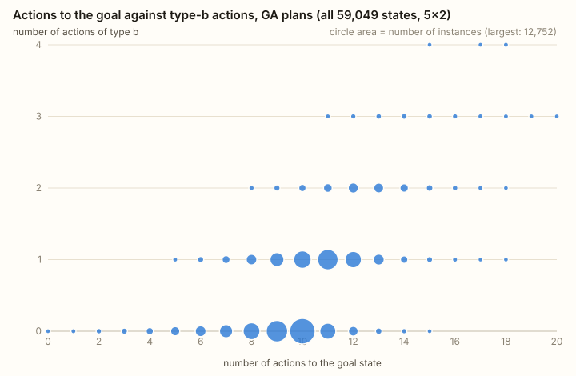
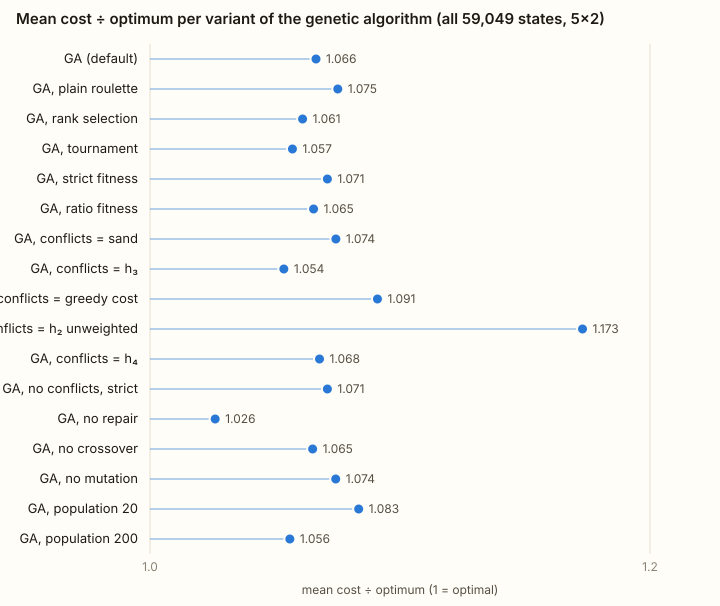
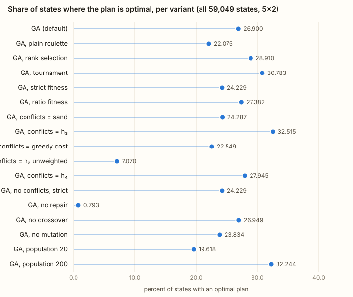
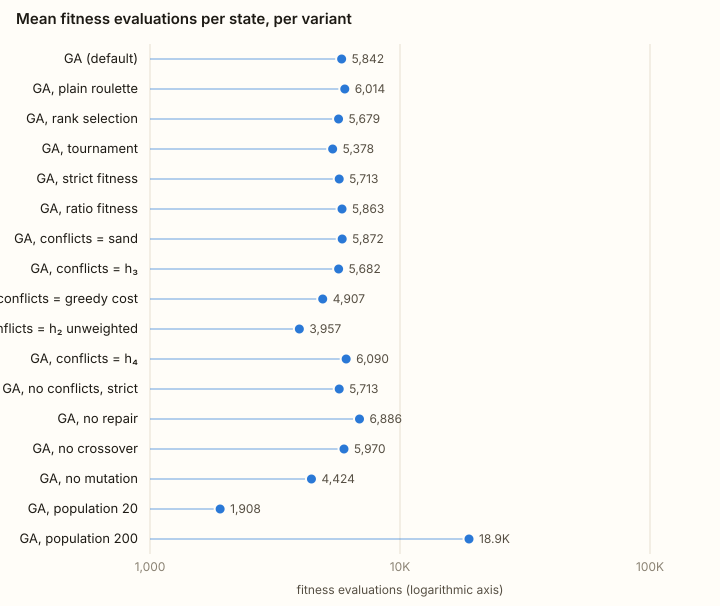
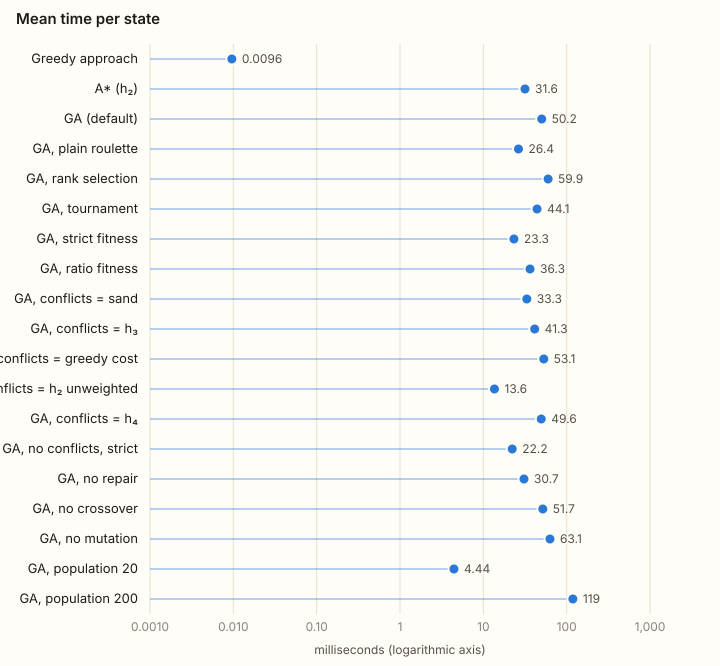

# تمرین سوم — نتایج الگوریتم ژنتیک روی همه‌ی ۵۹٬۰۴۹ استیت اولیه

الگوریتم ژنتیکِ شرح‌داده‌شده در [a3-genetic-design.fa.md](a3-genetic-design.fa.md) و گونه‌هایش، هر یک یک بار روی هر یک از ۵۹٬۰۴۹ استیت اولیه‌ی شبکه‌ی ۵×۲ اجرا و با بهینه مقایسه شده‌اند. همین نمودارها به شکل تعاملی در [برگه‌ی Evaluation](https://soyapo.github.io/sand-boxes/assignment-3/#eval) هستند؛ اعداد خام در `data/a3-5x2.json` است که با `node scripts/analyze.mjs --only a3-5x2.json` تولید می‌شود.

همان‌طور که صورت تمرین می‌خواهد، خودِ گزارش را دانشجویان می‌نویسند؛ این سند آن‌چه اندازه گرفته شد را ثبت می‌کند تا گزارش از آن نقل کند.

## ۱. چیدمان

| | |
|---|---|
| نمونه‌ها | همه‌ی ۳¹⁰ = ۵۹٬۰۴۹ استیت اولیه‌ی شبکه‌ی ۵×۲، فقط ماسه، همه‌ی دریچه‌ها بسته؛ یکی از آن‌ها (شبکه‌ی خالی) از ابتدا هدف است |
| بهینه | مقداردهی تکراری روی کل گراف استیت دست‌یافتنی (۳۲۶٬۰۴۱ استیت)، مانند تمرین ۱ و ۲ |
| اجرا به ازای هر استیت | ۱۹: روش حریصانه‌ی تمرین، A\* با h₂، الگوریتم ژنتیک پیش‌فرض و ۱۶ گونه‌ی آن |
| بذر تصادفی | برای هر استیت یکسان در همه‌ی گونه‌ها، پس گونه‌ها فقط در همان چیزی که عوض شده فرق دارند |
| پارامترهای پیش‌فرض | جمعیت ۶۰، حداکثر ۱۵۰ نسل، توقف پس از ۵۰ نسل بدون بهبود، طول ≤ ۲۰، نخبه ۲، ترکیب ۰٫۹، جهش ۰٫۳، رولت روی f − f_min، شایستگی `large − 9 · gates − cost`، ترمیم روشن |
| ماشین | Apple M5، ۱۰ هسته‌ی منطقی، Node.js 26، ۷ نخ کارگر |
| هزینه‌ی بهینه | میانگین ۵۰٫۹۹، میانه ۵۲، صدک ۹۵ام ۶۵، بیشینه ۷۶ |
| طول برنامه‌ی بهینه | میانگین ۱۱٫۱۸ عمل، بیشینه ۱۸؛ ۷۸٫۳٪ برنامه‌های بهینه دست‌کم یک دریچه‌ی کناری دارند |

**زمان‌ها.** ماشین یک بار در میانه‌ی اجرا به خواب رفت. اجراهایی که در آن لحظه در جریان بودند به جای میلی‌ثانیه دقیقه ثبت کردند و این *میانگین* ستون‌های زمان را متورم می‌کند؛ میانه‌ها اثر نگرفته‌اند و همان‌ها در زیر گزارش می‌شوند. اعداد کیفیت (موفقیت، بهینگی، نسبت هزینه، تعداد ارزیابی) هیچ وابستگی به زمان ندارند و دقیق‌اند.

## ۲. خلاصه

| | الگوریتم ژنتیک (پیش‌فرض) | روش حریصانه | A\* با h₂ |
|---|---:|---:|---:|
| به هدف می‌رسد | ۵۹٬۰۴۹ از ۵۹٬۰۴۹ (۱۰۰٪) | ۱۰۰٪ | ۱۰۰٪ |
| برنامه بهینه است | ۱۵٬۸۸۴ (۲۶٫۹٪) | ۱٬۴۸۹ (۲٫۵٪) | ۱۰۰٪ |
| میانگین هزینه ÷ بهینه | ۱٫۰۶۶ | ۱٫۱۸۰ | ۱ |
| میانه | ۱٫۰۶۲ | ۱٫۱۸۶ | ۱ |
| صدک ۹۵ام | ۱٫۱۷۵ | ۱٫۲۷۹ | ۱ |
| بدترین | ۱٫۵۵ | ۱٫۴۱ | ۱ |
| ارزیابی شایستگی / استیت گسترش‌یافته، میانگین | ۵٬۸۴۲ | ۹ | ۱۳٬۹۷۶ |
| عمل اجراشده / استیت تولیدشده، میانگین | ۵۱٬۲۵۵ | ۵۰ | ۹۵٬۴۳۰ |
| اوج حافظه | ۱۲۰ فرد | ۱ استیت | ۲۲٬۲۰۰ استیت (میانگین) |
| میانه‌ی زمان هر استیت | ۱۳٫۰ ms | ۰٫۰۰۸ ms | ۱۰٫۰ ms |

دو نکته از این جدول خوانده می‌شود. اول، **الگوریتم ژنتیک شدنی بودن را پیدا نمی‌کند، هزینه را بهینه می‌کند**: چون جمعیت اولیه از قدم‌زدن‌های مجاز تصادفی ساخته می‌شود، معمولاً در نسل صفر مسیر هدفی هست و نسل‌های بعد آن را ارزان‌تر می‌کنند. روی نمونه‌ای بذردار از ۴۰۰ استیت اولیه‌ی تصادفی ۵×۲، اولین مسیر هدف در ۳۶۹ مورد (۹۲٪) در نسل صفر ظاهر شد، تا نسل ۲ در ۳۹۶ مورد (۹۹٪)، و دیرترین در نسل ۳۸؛ به‌طور میانگین ۱۰٫۷٪ جمعیت اول از همان ابتدا به هدف می‌رسد (۳۰٪ در مثال ۴×۲ تمرین). دوم، این کار را با حدود ۴۰٪ ارزیابی‌های A\* و حافظه‌ی ثابت ۱۲۰ فرد می‌کند، ولی بهینگی را از دست می‌دهد: اضافه‌ی روش حریصانه نسبت به بهینه را نصف می‌کند (۶٫۶٪ در برابر ۱۸٫۰٪) نه حذف.

## ۳. GA_opt_ratio = هزینه‌ی الگوریتم ژنتیک ÷ هزینه‌ی بهینه

گونه‌ی پیش‌فرض، ۵۹٬۰۴۸ استیت دارای ماسه.

| نسبت | استیت‌ها | سهم |
|---|---:|---:|
| دقیقاً ۱ | ۱۵٬۸۸۳ | ۲۶٫۹٪ |
| (۱٫۰۰، ۱٫۰۵) | ۱۰٬۲۵۲ | ۱۷٫۴٪ |
| [۱٫۰۵، ۱٫۱۰) | ۱۶٬۱۴۰ | ۲۷٫۳٪ |
| [۱٫۱۰، ۱٫۱۵) | ۱۱٬۰۵۵ | ۱۸٫۷٪ |
| [۱٫۱۵، ۱٫۲۰) | ۴٬۱۷۷ | ۷٫۱٪ |
| [۱٫۲۰، ۱٫۲۵) | ۱٬۱۸۲ | ۲٫۰٪ |
| [۱٫۲۵، ۱٫۳۰) | ۲۷۱ | ۰٫۵٪ |
| [۱٫۳۰، ۱٫۳۵) | ۶۳ | ۰٫۱٪ |
| [۱٫۳۵، ۱٫۴۰) | ۲۰ | ۰٫۰٪ |
| [۱٫۴۰، ۱٫۴۵) | ۴ | ۰٫۰٪ |
| [۱٫۵۰، ۱٫۵۵] | ۱ | ۰٫۰٪ |


برای مقایسه، `Greedy_opt_ratio` روی همین استیت‌ها: ۲٫۵٪ دقیقاً ۱، مُد در [۱٫۱۵، ۱٫۲۵)، بیشینه ۱٫۴۱ (نمودار در [a2-report.fa.md](a2-report.fa.md)).

## ۴. دو نمودار پراکنش

**هزینه‌ی برنامه‌ی GA در برابر بهینه.** ابر نقطه‌ها درست بالای قطر می‌نشیند و با بزرگ شدن بهینه پهن می‌شود: استیت‌های گران، که برنامه‌های بلند با چند دریچه‌ی کناری می‌خواهند، جایی‌اند که الگوریتم کم می‌آورد.


**تعداد عمل‌ها در برابر تعداد عمل‌های دریچه‌ی کناری (نوع b)، برنامه‌های GA.** برنامه‌های GA به‌طور میانگین ۹٫۹۱ عمل دارند در برابر ۱۱٫۱۸ برای برنامه‌های بهینه، و فقط ۴۲٫۰٪ آن‌ها دریچه‌ی کناری دارند در برابر ۷۸٫۳٪ برنامه‌های بهینه. برنامه‌های ارزان این معما همان بلندهایی‌اند که پیش از تخلیه جعبه‌ها را از کنار هم‌سطح می‌کنند؛ الگوریتم برنامه‌های کوتاه‌تر و مستقیم‌تر را راحت‌تر پیدا می‌کند.



## ۵. بهینگی در برابر طول برنامه‌ی بهینه

سهم استیت‌هایی که برنامه‌ی گونه‌ی پیش‌فرض بهینه است، بر حسب تعداد عمل‌های برنامه‌ی بهینه:

| طول برنامه‌ی بهینه | استیت‌ها | GA بهینه | سهم |
|---:|---:|---:|---:|
| ≤ ۳ | ۸۱ | ۸۱ | ۱۰۰٪ |
| ۴ | ۱۹۶ | ۱۹۵ | ۹۹٫۵٪ |
| ۵ | ۵۳۸ | ۵۱۹ | ۹۶٫۵٪ |
| ۶ | ۹۷۳ | ۹۲۳ | ۹۴٫۹٪ |
| ۷ | ۱٬۸۰۳ | ۱٬۶۱۲ | ۸۹٫۴٪ |
| ۸ | ۳٬۳۸۸ | ۲٬۶۷۲ | ۷۸٫۹٪ |
| ۹ | ۵٬۷۸۹ | ۳٬۴۹۴ | ۶۰٫۴٪ |
| ۱۰ | ۹٬۱۵۵ | ۳٬۷۱۷ | ۴۰٫۶٪ |
| ۱۱ | ۱۰٬۴۹۶ | ۱٬۸۵۳ | ۱۷٫۷٪ |
| ۱۲ | ۹٬۶۴۶ | ۶۷۷ | ۷٫۰٪ |
| ۱۳ | ۷٬۵۹۴ | ۱۲۹ | ۱٫۷٪ |
| ۱۴ | ۵٬۳۲۷ | ۱۲ | ۰٫۲٪ |
| ۱۵ – ۱۸ | ۴٬۰۶۳ | ۰ | ۰٪ |

هدف در هر استیت و هر طولی به دست می‌آید؛ آن‌چه افت می‌کند بهینگی است. برنامه‌ای ۱۴ عملی با دریچه‌های کناری درست در جاهای درست، سوزنی در فضای دنباله‌های مجاز است و ۶۰ فرد در حداکثر ۱۵۰ نسل آن را پیدا نمی‌کنند.

## ۶. گونه‌ها

هر بار یک تغییر نسبت به پیش‌فرض. «هدف» سهم استیت‌هایی است که مسیر هدف پیدا شد و «بهینه» سهم آن‌هایی که بهینه بود.

| گونه | هدف | بهینه | میانگین هزینه ÷ بهینه | میانه | بدترین | میانگین ارزیابی | میانه‌ی زمان (ms) |
|---|---:|---:|---:|---:|---:|---:|---:|
| **GA (پیش‌فرض)** | ۱۰۰٪ | ۲۶٫۹٪ | ۱٫۰۶۶ | ۱٫۰۶۲ | ۱٫۵۵ | ۵٬۸۴۲ | ۱۳٫۰ |
| *انتخاب* | | | | | | | |
| رولت ساده pᵢ = fᵢ / Σf | ۱۰۰٪ | ۲۲٫۱٪ | ۱٫۰۷۵ | ۱٫۰۷۱ | ۱٫۳۸ | ۶٬۰۱۴ | ۱۴٫۹ |
| رتبه‌بندی خطی | ۱۰۰٪ | ۲۸٫۹٪ | ۱٫۰۶۱ | ۱٫۰۵۵ | ۱٫۵۰ | ۵٬۶۷۹ | ۱۱٫۹ |
| تورنمنت ۳تایی | ۱۰۰٪ | ۳۰٫۸٪ | ۱٫۰۵۷ | ۱٫۰۴۹ | ۱٫۵۲ | ۵٬۳۷۸ | ۱۰٫۷ |
| *شکل شایستگی* | | | | | | | |
| سخت‌گیرانه: L − cost در هدف، وگرنه ۰ | ۱۰۰٪ | ۲۴٫۲٪ | ۱٫۰۷۱ | ۱٫۰۶۸ | ۱٫۳۹ | ۵٬۷۱۳ | ۱۲٫۰ |
| نسبتی: L ÷ (1 + w·c + cost) | ۱۰۰٪ | ۲۷٫۴٪ | ۱٫۰۶۵ | ۱٫۰۶۱ | ۱٫۴۸ | ۵٬۸۶۳ | ۱۳٫۴ |
| *conflict_numbers* | | | | | | | |
| ماسه‌ی باقی‌مانده × ۹ | ۱۰۰٪ | ۲۴٫۳٪ | ۱٫۰۷۴ | ۱٫۰۶۵ | ۱٫۵۲ | ۵٬۸۷۲ | ۱۳٫۸ |
| فاصله‌ی سقوط h₃ × ۱٫۲ | ۱۰۰٪ | ۳۲٫۵٪ | ۱٫۰۵۴ | ۱٫۰۴۲ | ۱٫۴۸ | ۵٬۶۸۲ | ۱۲٫۸ |
| هزینه‌ی روش حریصانه از همان استیت | ۱۰۰٪ | ۲۲٫۵٪ | ۱٫۰۹۱ | ۱٫۰۷۷ | ۱٫۸۰ | ۴٬۹۰۷ | ۱۴٫۲ |
| h₂ بی‌وزن (قابل‌قبول) | ۹۹٫۹۹٪ | ۷٫۱٪ | ۱٫۱۷۳ | ۱٫۱۷۰ | ۱٫۷۱ | ۳٬۹۵۷ | ۶٫۶ |
| برآورد رگرسیون h₄ × ۱٫۳۵ | ۱۰۰٪ | ۲۷٫۹٪ | ۱٫۰۶۸ | ۱٫۰۵۹ | ۱٫۵۱ | ۶٬۰۹۰ | ۱۵٫۹ |
| هیچ، شایستگی سخت‌گیرانه | ۱۰۰٪ | ۲۴٫۲٪ | ۱٫۰۷۱ | ۱٫۰۶۸ | ۱٫۳۹ | ۵٬۷۱۳ | ۱۰٫۴ |
| *عملگرها* | | | | | | | |
| بدون ترمیم (شناسه‌ی تصادفی، غیرمجاز ← ۰) | ۱٫۱٪ | ۰٫۸٪ | ۱٫۰۲۶ | ۱٫۰۰۰ | ۱٫۳۰ | ۶٬۸۸۶ | ۷٫۴ |
| بدون ترکیب | ۱۰۰٪ | ۲۶٫۹٪ | ۱٫۰۶۵ | ۱٫۰۶۰ | ۱٫۵۵ | ۵٬۹۷۰ | ۹٫۳ |
| بدون جهش | ۹۹٫۹۶٪ | ۲۳٫۸٪ | ۱٫۰۷۴ | ۱٫۰۶۹ | ۱٫۷۴ | ۴٬۴۲۴ | ۹٫۲ |
| *جمعیت* | | | | | | | |
| ۲۰ | ۹۹٫۹۸٪ | ۱۹٫۶٪ | ۱٫۰۸۳ | ۱٫۰۷۸ | ۱٫۷۸ | ۱٬۹۰۸ | ۴٫۱ |
| ۲۰۰ | ۱۰۰٪ | ۳۲٫۲٪ | ۱٫۰۵۶ | ۱٫۰۴۷ | ۱٫۳۷ | ۱۸٬۸۸۱ | ۴۳٫۳ |





آن‌چه حذف‌ها می‌گویند:

* **ترمیم خودِ الگوریتم است.** بدون آن (شناسه‌های عمل یکنواخت تصادفی، دنباله‌های غیرمجاز با نمره‌ی ۰ همان‌طور که تمرین می‌گوید) مسیر هدف روی ۶۴۴ استیت، ۱٫۱٪، پیدا می‌شود و فقط جایی که برنامه‌ی بهینه کوتاه است: هر ۴ استیت با بهینه‌ی یک‌عملی، ۱۵ از ۱۶ با دو عمل، ۵۱ از ۶۰ با سه، سپس ۹۵ از ۱۹۶، ۹۲ از ۵۳۸، و هیچ‌چیز فراتر از ۱۴ عمل. برنامه‌هایی که پیدا می‌کند اغلب بهینه‌اند چون همان برنامه‌های کوتاهی‌اند که یک دنباله‌ی تصادفی می‌تواند به آن بخورد.
* **شمارش تعارض بدبینانه لازم است.** با h₂ قابل‌قبولِ بی‌وزن، شایسته‌ترین فرد یک مسیر کوتاه ناتمام است (یادداشت‌های طراحی، بخش ۴٫۲)؛ مسیرهای هدف همچنان به عنوان محصول جانبی قدم‌زدن‌های تصادفی ظاهر می‌شوند، پس هدف به دست می‌آید، ولی برنامه‌ها از روش حریصانه بهتر نیستند (بهینه روی ۷٫۱٪، نسبت میانگین ۱٫۱۷۳ در برابر ۱٫۱۸۰ حریصانه). همان h₂ به شکل شمار دریچه‌ها و ضرب در بیشینه‌ی هزینه‌ی عمل، ۹، پیش‌فرض است و ۲۶٫۹٪ می‌دهد.
* **میان برآوردهای بدبینانه، ریزتر برنده است.** فاصله‌ی سقوط h₃ که هر نیم‌واحد ماسه را با دریچه‌های زیرش وزن می‌دهد بهترین تابع تعارض آزموده‌شده است (۳۲٫۵٪ بهینه، نسبت ۱٫۰۵۴). شمارش ساده‌ی ماسه ضعیف‌ترینِ شمارش‌هاست (۲۴٫۳٪). هزینه‌ی روش حریصانه، یک کران بالای دقیق، در میان برآوردهای وزن‌دار بدترین است (۲۲٫۵٪، بدترین حالت ۱٫۸۰). دلیل محتمل: روی ۱۰٪ استیت‌ها برابر h\* است و آن‌جا مسیر ناتمام با تکمیل خودش مساوی می‌شود و فشار برای تمام کردن از بین می‌رود.
* **ثابتِ درون شایستگی برای رولت مهم است.** چرخ کتاب درسی روی شایستگی خام، که هر مقدارش `large_number` منهای چیزی است، ضعیف‌ترین انتخاب است (۲۲٫۱٪). کم کردن بدترین شایستگی (پیش‌فرض) ۲۶٫۹٪ می‌دهد، رتبه‌بندی ۲۸٫۹٪، تورنمنت ۳تایی ۳۰٫۸٪: هر چه روش بیشتر به ترتیب وابسته باشد تا به مقدار، بهتر.
* **شکل سخت‌گیرانه این‌جا کار می‌کند، به دلیلی خاص این مسئله.** صفر دادن به هر مسیر ناتمام کمتر از سه واحد درصد هزینه دارد (۲۴٫۲٪ در برابر ۲۶٫۹٪)، چون قدم‌زدن‌های مجاز تصادفی آن‌قدر به هدف می‌رسند که انتخاب فقط روی مسیرهای هدف کار کند. با شکل `strict` تابع تعارض بی‌اثر است، چنان‌که ردیف یکسانِ «هیچ، سخت‌گیرانه» نشان می‌دهد. شکل نسبتی به خوبی پیش‌فرض است (۲۷٫۴٪)؛ دلیل محتمل این است که پنجره‌ای که پیش از چرخ کم می‌شود بیشترِ فشرده‌سازی تفاوت‌ها را خنثی می‌کند.
* **ترکیب و جهش تک‌تک قابل حذف‌اند، با هم نه.** بدون ترکیب چیز قابل اندازه‌گیری‌ای تغییر نمی‌کند (۲۶٫۹٪)؛ بدون جهش سه واحد درصد کم می‌شود و ۲۳ استیت حل‌نشده می‌ماند و بدترین نسبت به ۱٫۷۴ می‌رسد: بدون ویرایش‌های تصادفی جمعیت می‌تواند روی برنامه‌ای گیر کند که نمی‌تواند ترکش کند.
* **اندازه‌ی جمعیت کیفیت را تقریباً لگاریتمی می‌خرد.** ۲۰ فرد: ۱۹٫۶٪ با ۱٬۹۰۸ ارزیابی؛ ۶۰: ۲۶٫۹٪ با ۵٬۸۴۲؛ ۲۰۰: ۳۲٫۲٪ با ۱۸٬۸۸۱. ده برابر ارزیابی برای ۱۳ واحد درصد.

## ۷. تلاش و زمان

| | میانگین ارزیابی / گسترش | میانگین عمل اجراشده / تولید | اوج حافظه | میانه‌ی زمان هر استیت |
|---|---:|---:|---:|---:|
| GA (پیش‌فرض) | ۵٬۸۴۲ | ۵۱٬۲۵۵ | ۱۲۰ | ۱۳٫۰ ms |
| GA، جمعیت ۲۰ | ۱٬۹۰۸ | ۱۸٬۰۵۸ | ۴۰ | ۴٫۱ ms |
| GA، جمعیت ۲۰۰ | ۱۸٬۸۸۱ | ۱۵۴٬۴۸۲ | ۴۰۰ | ۴۳٫۳ ms |
| A\* با h₂ | ۱۳٬۹۷۶ | ۹۵٬۴۳۰ | ۲۲٬۲۰۰ (میانگین) | ۱۰٫۰ ms |
| روش حریصانه | ۹ | ۵۰ | ۱ | ۰٫۰۰۸ ms |

حافظه‌ی الگوریتم ژنتیک جمعیت و فرزندانش است، ۲ × جمعیت فرد، مستقل از استیت؛ حافظه‌ی A\* با نمونه رشد می‌کند (تا ۱۳۰٬۷۰۱ استیت روی سخت‌ترین). در زمان هر استیت این دو روی این شبکه نزدیک‌اند، چون A\* با هیوریستیک خوب این‌جا سریع است؛ مزیت الگوریتم ژنتیک این است که هزینه‌اش را پارامترها تعیین می‌کنند نه نمونه.





## ۸. مثال تمرین

روی مثال ۴×۲ (بهینه ۳۸، روش حریصانه ۴۷، برنامه‌ی دریچه‌ی کناری تمرین ۴۵)، اجرای پیش‌فرض با بذر ۱ برنامه‌ای با هزینه‌ی ۴۲ در ۸ عمل برمی‌گرداند که در نسل ۵ پیدا و در ۵۰ نسل بعدی بدون بهبود تأیید می‌شود، پس از ۴٬۱۹۳ ارزیابی شایستگی. روی بذرهای ۱ تا ۱۰، پیش‌فرض چهار بار بهینه‌ی ۳۸ و شش بار ۴۲ را پیدا می‌کند (میانگین ۴۰٫۴)؛ با h₃ به عنوان تابع تعارض نه بار ۳۸ و یک بار ۴۱ (میانگین ۳۸٫۳). برگه‌ی Evolve هر یک از این اجراها را نسل به نسل بازپخش می‌کند.

## ۹. بازتولید

```bash
node scripts/analyze.mjs --only a3-5x2.json      # همه‌ی گونه‌ها روی همه‌ی ۵۹٬۰۴۹ استیت (حدود ۴۵ دقیقه روی ۷ هسته)
node scripts/figures.mjs                         # نمودارهای بالا، در docs/figures/
npm run evolve -- "1 0 / 0 1 / 0 1 / 1 0"        # یک اجرا با لاگ هر نسل
npm run evolve -- "1 0 / 0 1 / 0 1 / 1 0" --compare
npm test                                         # شامل آزمون‌های الگوریتم ژنتیک
```
