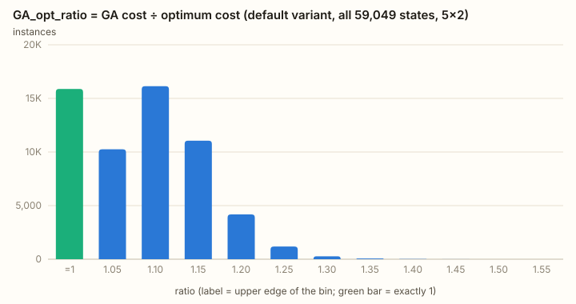
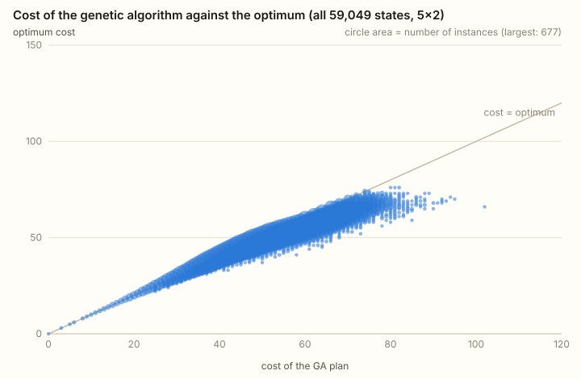
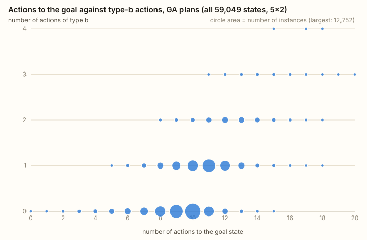
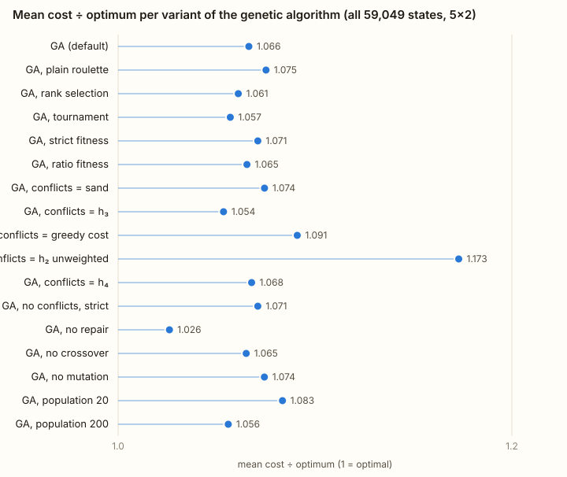

# Assignment 3 — execution and evaluation report: the genetic algorithm against A* and UCS

Deliverable 6 of the brief asks for the performance of the genetic algorithm against at least
one state-space search: the number of successes on 100 random problems with different initial
states, the share of those successes whose path cost is optimal (equal to A\* / UCS), and the
mean of `GA_Path_cost / optimum_path_cost`, once over all 100 problems and once over the
successes only. Section 1 gives exactly that, for the default configuration and for every
alternative described in [a3-genetic-design.md](a3-genetic-design.md), on the 5×2 and the 6×2
grid. Section 2 adds a larger run over all 59,049 initial states of the 5×2 grid made with the
first version of the algorithm. The raw numbers are in `data/a3-random100.json` and
`data/a3-5x2.json`; the [Evaluation tab](https://soyapo.github.io/sand-boxes/assignment-3/#eval)
draws both.

## 1. 100 random problems, GA against A\* and UCS

### 1.1 Setup

| | |
|---|---|
| Problems | 100 distinct random initial states per grid size, drawn with the assignment's probabilities (empty 0.5, full 0.3, half 0.2), seed 1; the 5×2 grid and the harder 6×2 grid |
| Reference | A\* with h₂ and uniform-cost search on every problem; they agree on every optimum |
| GA | one run per problem and configuration, seed 1 mixed with the initial state; the default configuration and 12 alternatives, each changing one thing |
| Defaults | population 60, at most 150 generations, stop after 50 without improvement, length bound 4 per row (20 and 24), elite 2, crossover 0.9, mutation 0.3, roulette on f − f_min, fitness `L − 9·gates − cost`, conflict number = smallest along the sequence, all six mutations, single-point crossover, repair |
| Convention | when the GA does not reach the goal, `GA_Path_cost` is the path cost of the fittest sequence it returned: an unfinished path, so cheap (and in the "illegal kept with fitness 0" configuration an arbitrary illegal sequence, whose cost is that of its legal prefix). The all-problems mean of a failing configuration therefore drops *below* 1; the per-problem rows keep the two numbers apart |
| Noise | one seed per problem; a difference of four or five problems in 100 between two configurations is within what another seed would change, so only the larger gaps below are read as differences |
| Machine | Apple M5, Node.js 26, one thread; 44 s for the 5×2 set, 233 s for the 6×2 set (A\* and UCS dominate the latter) |

`node scripts/evaluate-ga.mjs` reproduces both sets.

### 1.2 The four numbers of the brief, default configuration

<!-- gen:headline -->
| | 5×2 | 6×2 |
|---|---:|---:|
| Problems | 100 | 100 |
| Mean optimal cost (max) | 43.6 (69) | 57.5 (81) |
| Mean optimal plan length (max) | 9.9 actions (15) | 12.7 actions (20) |
| **GA successes (goal reached)** | **100 / 100** | **100 / 100** |
| **Successes with the optimal path cost** | **48 (48%)** | **25 (25%)** |
| **Mean GA_Path_cost ÷ optimum, all 100** | **1.041** | **1.075** |
| **Mean ratio, successes only** | **1.041** | **1.075** |
| Worst ratio | 1.24 | 1.36 |
| Mean excess of the non-optimal solutions | 7.9% | 10.1% |
| Mean fitness evaluations | 5,283 | 6,326 |
| Mean generations run | 69.2 | 83.0 |
| Median time per problem | 24.5 ms | 46.7 ms |
| A\*: mean states expanded, median time | 6,085 · 5.6 ms | 75,825 · 82.3 ms |
| UCS: mean states expanded, median time | 15,638 · 7.2 ms | 189,817 · 129.5 ms |
<!-- /gen:headline -->
<!-- gen:dist -->
Distribution of the ratio for the default configuration. 5x2: exactly 1 on 48, (1.00, 1.05) on 21, [1.05, 1.10) on 14, [1.10, 1.15) on 12, [1.15, 1.20) on 2, [1.20, 1.25) on 3. 6x2: exactly 1 on 25, (1.00, 1.05) on 20, [1.05, 1.10) on 20, [1.10, 1.15) on 21, [1.15, 1.20) on 9, [1.20, 1.25) on 3, [1.25, 1.30) on 1, [1.35, 1.40) on 1.
<!-- /gen:dist -->

What the numbers say:

* **The genetic algorithm reaches the goal on every problem**, on both grids, and a goal path is
  already present in generation 0 on every one of them (mean "first goal in generation" 0.00).
  The initial population consists of random legal walks of the full length, and in this puzzle
  such a walk empties the grid more often than not. The algorithm's work is therefore not to find
  a solution but to make it cheap.
* **Half of the 5×2 solutions are optimal, a quarter of the 6×2 ones.** The non-optimal ones are
  8% (5×2) and 10% (6×2) above the optimum on average and never more than 36% above it. For
  comparison, the greedy approach of Assignment 1 is 18% above the optimum on average on the 5×2
  grid.
* **Against A\* and UCS.** Both searches are exact, the genetic algorithm is not. On the 5×2 grid
  A\* is also faster (median 6 ms against 25 ms); on the 6×2 grid the orders reverse (82 ms
  against 47 ms) and UCS is three times slower than the GA, because the searches grow with the
  state space while the GA's cost is set by its parameters: about 6,300 evaluations and a memory
  of 120 individuals whatever the instance, against 75,825 expanded states for A\*. One row
  larger again, on a 7×2 instance with 15 half-units of sand, the GA returned a plan of cost 113
  in 90 ms (the greedy approach: 112), while A\* and UCS run back to back on 7×2 instances
  exceeded Node's default heap in our test; whether the GA's plans stay near the optimum there we
  cannot say, because no optimum is available.

### 1.3 Every configuration

5×2, 100 problems:

<!-- gen:configs-5x2 -->
| Configuration | Successes | Optimal (of successes) | Mean ratio, all | Mean ratio, successes | Worst | Mean evaluations | Median ms |
|---|---:|---:|---:|---:|---:|---:|---:|
| **GA (default)** | 100 | 48 (48%) | 1.041 | 1.041 | 1.24 | 5,283 | 24.5 |
| conflicts of the end state | 100 | 46 (46%) | 1.041 | 1.041 | 1.22 | 5,130 | 13.8 |
| mutations of the brief only (replace, swap, reverse) | 100 | 47 (47%) | 1.040 | 1.040 | 1.25 | 5,213 | 21.9 |
| double-point crossover | 100 | 50 (50%) | 1.039 | 1.039 | 1.18 | 5,300 | 27.5 |
| lethal mutation: retry instead of repair | 100 | 30 (30%) | 1.081 | 1.081 | 1.48 | 15,710 | 19.5 |
| illegal kept with fitness 0, no repair | 7 | 7 (100%) | 0.439 | 1.000 | 1.00 | 7,012 | 7.8 |
| strict fitness (0 unless the goal is reached) | 100 | 45 (45%) | 1.043 | 1.043 | 1.19 | 5,230 | 23.6 |
| conflicts = boxes with sand | 100 | 21 (21%) | 1.090 | 1.090 | 1.39 | 4,480 | 11.7 |
| conflicts = h₃ (fall distance) | 100 | 52 (52%) | 1.035 | 1.035 | 1.16 | 5,347 | 21.7 |
| conflicts = h₂ unweighted (admissible) | 100 | 25 (25%) | 1.097 | 1.097 | 1.36 | 4,122 | 9.6 |
| plain roulette | 100 | 36 (36%) | 1.056 | 1.056 | 1.21 | 5,218 | 23.7 |
| tournament selection | 100 | 48 (48%) | 1.033 | 1.033 | 1.15 | 5,093 | 20.0 |
| population 20 | 100 | 33 (33%) | 1.054 | 1.054 | 1.43 | 1,759 | 7.1 |
| population 200 | 100 | 64 (64%) | 1.028 | 1.028 | 1.17 | 16,610 | 80.2 |
| A\* with h₂ | 100 | 100 (100%) | 1 | 1 | 1 | 6,085 expanded | 5.6 |
| UCS | 100 | 100 (100%) | 1 | 1 | 1 | 15,638 expanded | 7.2 |
<!-- /gen:configs-5x2 -->

6×2, 100 problems:

<!-- gen:configs-6x2 -->
| Configuration | Successes | Optimal (of successes) | Mean ratio, all | Mean ratio, successes | Worst | Mean evaluations | Median ms |
|---|---:|---:|---:|---:|---:|---:|---:|
| **GA (default)** | 100 | 25 (25%) | 1.075 | 1.075 | 1.36 | 6,326 | 46.7 |
| conflicts of the end state | 100 | 22 (22%) | 1.079 | 1.079 | 1.32 | 6,253 | 24.5 |
| mutations of the brief only (replace, swap, reverse) | 100 | 24 (24%) | 1.078 | 1.078 | 1.38 | 6,420 | 35.9 |
| double-point crossover | 100 | 21 (21%) | 1.076 | 1.076 | 1.33 | 6,293 | 52.7 |
| lethal mutation: retry instead of repair | 100 | 19 (19%) | 1.171 | 1.171 | 1.59 | 18,648 | 28.2 |
| illegal kept with fitness 0, no repair | 0 | — | 0.321 | — | — | 7,071 | 8.9 |
| strict fitness (0 unless the goal is reached) | 100 | 26 (26%) | 1.073 | 1.073 | 1.23 | 6,191 | 49.3 |
| conflicts = boxes with sand | 100 | 10 (10%) | 1.179 | 1.179 | 1.48 | 4,586 | 16.0 |
| conflicts = h₃ (fall distance) | 100 | 28 (28%) | 1.062 | 1.062 | 1.25 | 5,655 | 38.9 |
| conflicts = h₂ unweighted (admissible) | 100 | 10 (10%) | 1.172 | 1.172 | 1.48 | 4,208 | 15.6 |
| plain roulette | 100 | 19 (19%) | 1.090 | 1.090 | 1.31 | 6,611 | 56.9 |
| tournament selection | 100 | 30 (30%) | 1.053 | 1.053 | 1.23 | 5,927 | 38.6 |
| population 20 | 100 | 19 (19%) | 1.095 | 1.095 | 1.42 | 2,072 | 13.7 |
| population 200 | 100 | 30 (30%) | 1.058 | 1.058 | 1.23 | 20,244 | 144.8 |
| A\* with h₂ | 100 | 100 (100%) | 1 | 1 | 1 | 75,825 expanded | 82.3 |
| UCS | 100 | 100 (100%) | 1 | 1 | 1 | 189,817 expanded | 129.5 |
<!-- /gen:configs-6x2 -->

### 1.4 What the alternatives say about the seven steps

* **Step 4, the conflict number.** The brief's rule, the smallest value along the sequence, is
  slightly ahead of the end-state value (48% against 46% optimal on 5×2, 25% against 22% on
  6×2), a gap within the noise of one seed. The *kind* of count matters far more: the brief's
  example count, boxes with sand, is the weakest (21% and 10%) because it does not see how deep the
  sand sits, and the admissible h₂ used unweighted is just as weak (25% and 10%, ratio 1.10 and
  1.17) for the reason given in the design notes: it rewards stopping short. The fall distance
  h₃, which weighs every half-unit by the gates below it, is as good as or slightly better than
  the gate count (52% / 28%).
* **Step 5, the fitness.** The strict form (0 unless the goal is reached) is within noise of the
  default (45% / 26% against 48% / 25%): it works here because random legal walks reach the goal,
  and it gives selection nothing to prefer among unfinished paths, which on this puzzle costs
  little.
* **Step 6, operators.** Repair against the brief's lethal mutation is the one clear operator
  result: 48% against 30% optimal on 5×2 and 25% against 19% on 6×2, with a third of the
  evaluations (a likely reason: most redraws of a swap or a reverse are illegal, so the children
  that survive are the small edits). Without repair or retry (illegal children kept with fitness 0)
  the goal is reached on 7 problems of 100 on 5×2, all with optimal plans of at most six actions,
  and on none on 6×2; the all-problems ratio of 0.44 and 0.32 there is the artefact of the
  convention, not a result. The brief's three mutations alone (47% / 24%) and double-point
  crossover (50% / 21%) are within noise of the default; the length-changing mutations and the
  single-point crossover are kept as defaults for the reasons in the design notes, not because the
  measurement decides it.
* **Step 7, selection.** Plain roulette is the weakest method (36% / 19%), for the reason given
  in the design notes: with `large_number` inside every fitness the wheel is nearly uniform.
  Subtracting the worst fitness (the default) gives 48% / 25%; the tournament of three 48% / 30%.
* **Effort.** Population 200 buys 16 points on 5×2 for three times the evaluations and five on
  6×2: on the larger grid the length of the plans, more than the size of the population, is the
  limit. Population 20 runs in 7 ms and still solves everything, at 33% optimal.

### 1.5 The assignment's example

On the 4×2 example (optimum 38, greedy approach 47, the assignment's side-gate plan 45), the
default configuration over the seeds 1 to 10 finds the optimum 38 five times, 41 once and 42
four times (length bound 16, mean 39.9); with h₃ as the conflict number it finds 38 eight times
and 41 and 42 once each (mean 38.7). The Evolve tab replays any of these runs generation by
generation.

## 2. Every initial state of the 5×2 grid (first version of the algorithm)

This run covers all 3¹⁰ = 59,049 initial states, 19 runs each, with the optimum from value
iteration over the whole state graph. It was made with the **first version** of the algorithm,
which differed from the current defaults in three ways: the conflict number was taken at the end
state (not the smallest along the sequence), the initial walks had random lengths up to the
bound, and only the four mutations replace / insert / delete / regrow existed. It has not been
recomputed (about 45 minutes of every core); it is kept because its comparison of selection
methods, fitness forms and conflict functions is broadly consistent with section 1, and because
its size gives the finer pictures below.

### 2.1 Headline

| | GA (first version, default) | Greedy approach | A\* with h₂ |
|---|---:|---:|---:|
| Reaches the goal | 59,049 of 59,049 (100%) | 100% | 100% |
| Plan is optimal | 15,884 (26.9%) | 1,489 (2.5%) | 100% |
| Mean cost ÷ optimum | 1.066 | 1.180 | 1 |
| Median | 1.062 | 1.186 | 1 |
| 95th percentile | 1.175 | 1.279 | 1 |
| Worst | 1.55 | 1.41 | 1 |
| Fitness evaluations / states expanded, mean | 5,842 | 9 | 13,976 |
| Actions applied / states generated, mean | 51,255 | 50 | 95,430 |
| Peak memory | 120 individuals | 1 state | 22,200 states (mean) |
| Median time per state | 13.0 ms | 0.008 ms | 10.0 ms |

Times are medians: the machine slept once during this run, which inflated a few individual
timings and with them the means; the quality numbers do not depend on timing and are exact.

### 2.2 GA_opt_ratio = cost of the genetic algorithm ÷ optimum cost

| Ratio | States | Share |
|---|---:|---:|
| exactly 1 | 15,883 | 26.9% |
| (1.00, 1.05) | 10,252 | 17.4% |
| [1.05, 1.10) | 16,140 | 27.3% |
| [1.10, 1.15) | 11,055 | 18.7% |
| [1.15, 1.20) | 4,177 | 7.1% |
| [1.20, 1.25) | 1,182 | 2.0% |
| [1.25, 1.30) | 271 | 0.5% |
| [1.30, 1.35) | 63 | 0.1% |
| [1.35, 1.40) | 20 | 0.0% |
| [1.40, 1.45) | 4 | 0.0% |
| [1.50, 1.55] | 1 | 0.0% |



### 2.3 The two scatter plots

The cloud of GA cost against the optimum sits just above the diagonal and widens with the
optimum: the expensive states, which need long plans with several side gates, are where the
algorithm falls short.



The GA's plans have 9.91 actions on average against 11.18 for the optimal plans, and only 42.0%
of them use a side gate against 78.3% of the optimal plans: the cheap plans of this puzzle are the
long ones that level boxes sideways before flushing, and the algorithm finds the shorter,
straighter plans more easily.



### 2.4 Optimality against the length of the optimal plan

| Optimal plan length | States | GA optimal | Share |
|---:|---:|---:|---:|
| ≤ 3 | 81 | 81 | 100% |
| 4 | 196 | 195 | 99.5% |
| 5 | 538 | 519 | 96.5% |
| 6 | 973 | 923 | 94.9% |
| 7 | 1,803 | 1,612 | 89.4% |
| 8 | 3,388 | 2,672 | 78.9% |
| 9 | 5,789 | 3,494 | 60.4% |
| 10 | 9,155 | 3,717 | 40.6% |
| 11 | 10,496 | 1,853 | 17.7% |
| 12 | 9,646 | 677 | 7.0% |
| 13 | 7,594 | 129 | 1.7% |
| 14 | 5,327 | 12 | 0.2% |
| 15 – 18 | 4,063 | 0 | 0% |

The goal is reached on every state at every length; what degrades is optimality. A plan of 14
actions with the right side gates in the right places is a needle in the space of legal
sequences, and 60 individuals for at most 150 generations do not find it.

### 2.5 Variants (first version)

| Variant | Goal | Optimal | Mean cost ÷ opt | Median | Worst | Mean evaluations | Median ms |
|---|---:|---:|---:|---:|---:|---:|---:|
| **default (end-state conflicts)** | 100% | 26.9% | 1.066 | 1.062 | 1.55 | 5,842 | 13.0 |
| plain roulette | 100% | 22.1% | 1.075 | 1.071 | 1.38 | 6,014 | 14.9 |
| linear ranking | 100% | 28.9% | 1.061 | 1.055 | 1.50 | 5,679 | 11.9 |
| tournament of 3 | 100% | 30.8% | 1.057 | 1.049 | 1.52 | 5,378 | 10.7 |
| strict fitness | 100% | 24.2% | 1.071 | 1.068 | 1.39 | 5,713 | 12.0 |
| ratio fitness | 100% | 27.4% | 1.065 | 1.061 | 1.48 | 5,863 | 13.4 |
| conflicts = sand × 9 | 100% | 24.3% | 1.074 | 1.065 | 1.52 | 5,872 | 13.8 |
| conflicts = h₃ × 1.2 | 100% | 32.5% | 1.054 | 1.042 | 1.48 | 5,682 | 12.8 |
| conflicts = greedy cost | 100% | 22.5% | 1.091 | 1.077 | 1.80 | 4,907 | 14.2 |
| conflicts = h₂ unweighted | 99.99% | 7.1% | 1.173 | 1.170 | 1.71 | 3,957 | 6.6 |
| conflicts = h₄ × 1.35 | 100% | 27.9% | 1.068 | 1.059 | 1.51 | 6,090 | 15.9 |
| none, strict fitness | 100% | 24.2% | 1.071 | 1.068 | 1.39 | 5,713 | 10.4 |
| illegal kept with fitness 0 | 1.1% | 0.8% | 1.026 | 1.000 | 1.30 | 6,886 | 7.4 |
| no crossover | 100% | 26.9% | 1.065 | 1.060 | 1.55 | 5,970 | 9.3 |
| no mutation | 99.96% | 23.8% | 1.074 | 1.069 | 1.74 | 4,424 | 9.2 |
| population 20 | 99.98% | 19.6% | 1.083 | 1.078 | 1.78 | 1,908 | 4.1 |
| population 200 | 100% | 32.2% | 1.056 | 1.047 | 1.37 | 18,881 | 43.3 |




Findings that section 1 does not already cover: the admissible h₂ used unweighted as the
conflict number drops optimality to 7.1% and the ratio to the greedy level (1.173), as predicted
in the design notes; the greedy cost as conflict number, an exact upper bound, is the worst of the
weighted estimates (22.5%, worst case 1.80), most likely because where it is tight a partial path
ties with its own completion; removing crossover changes nothing measurable while removing
mutation costs three points and leaves 23 states unsolved; the ratio form of the fitness is as
good as the subtraction form.

## 3. Reproducing

```bash
node scripts/evaluate-ga.mjs                     # section 1: 100 random problems, 5×2 and 6×2 (about 5 minutes, one thread)
node scripts/analyze.mjs --only a3-5x2.json      # section 2: every variant on all 59,049 states (about 45 minutes, every core)
node scripts/figures.mjs                         # the figures above, into docs/figures/
npm run evolve -- "1 0 / 0 1 / 0 1 / 1 0"        # one run with the log of every generation
npm run evolve -- "1 0 / 0 1 / 0 1 / 1 0" --compare
npm test
```
