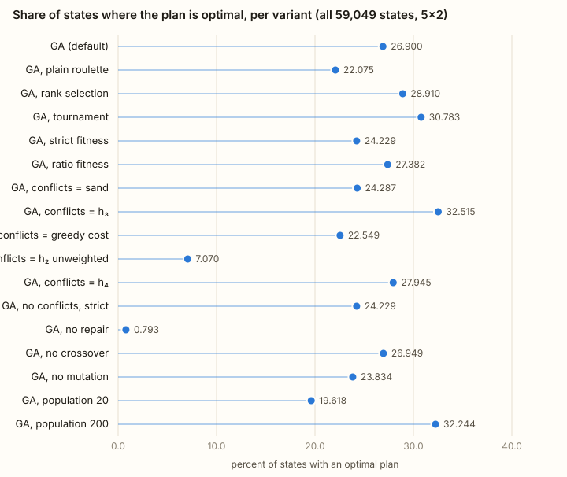
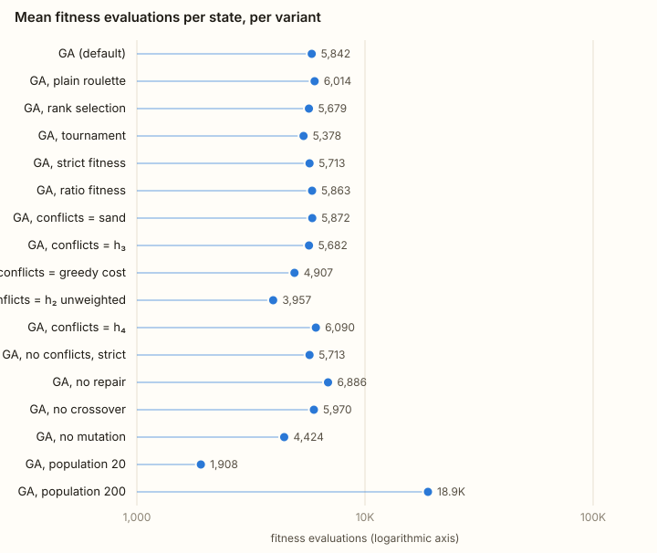

# Assignment 3 — results of the genetic algorithm on all 59,049 initial states

The genetic algorithm described in [a3-genetic-design.md](a3-genetic-design.md) and its
variants, run once on each of the 59,049 initial states of the 5×2 grid and compared with the
optimum. The same page of figures is interactive on the
[Evaluation tab](https://soyapo.github.io/sand-boxes/assignment-3/#eval); the raw numbers are in
`data/a3-5x2.json`, produced by `node scripts/analyze.mjs --only a3-5x2.json`.

As the brief asks, the report proper is for the students to write; this document records what
was measured, so that the report can quote it.

## 1. Setup

| | |
|---|---|
| Instances | all 3¹⁰ = 59,049 initial states of the 5×2 grid, sand only, every gate closed; one of them (the empty grid) is already a goal |
| Optimum | value iteration over the whole reachable state graph (326,041 states), as in Assignments 1 and 2 |
| Runs per state | 19: the greedy approach of the assignment, A\* with h₂, the default genetic algorithm and 16 variants of it |
| Random seed | the same seed per state for every variant, so the variants differ only in what is changed |
| Default parameters | population 60, at most 150 generations, stop after 50 without improvement, length ≤ 20, elite 2, crossover 0.9, mutation 0.3, roulette on f − f_min, fitness `large − 9 · gates − cost`, repair on |
| Machine | Apple M5, 10 logical cores, Node.js 26, 7 worker threads |
| Optimal cost | mean 50.99, median 52, 95th percentile 65, maximum 76 |
| Optimal plan length | mean 11.18 actions, maximum 18; 78.3% of optimal plans use at least one side gate |

**Timings.** The machine slept once during the run. The runs in flight at that moment recorded
minutes instead of milliseconds, which inflates the *means* of the time columns; the medians are
unaffected and are what is reported below. The quality numbers (success, optimality, cost
ratios, evaluations) do not depend on timing at all and are exact.

## 2. Headline

| | Genetic algorithm (default) | Greedy approach | A\* with h₂ |
|---|---:|---:|---:|
| Reaches the goal | 59,049 of 59,049 (100%) | 100% | 100% |
| Plan is optimal | 15,884 (26.9%) | 1,489 (2.5%) | 100% |
| Mean cost ÷ optimum | 1.066 | 1.180 | 1 |
| Median | 1.062 | 1.186 | 1 |
| 95th percentile | 1.175 | 1.279 | 1 |
| Worst | 1.55 | 1.41 | 1 |
| Fitness evaluations / states expanded, mean | 5,842 | 9 | 13,976 |
| Actions applied / states generated, mean | 51,255 | 50 | 95,430 |
| Peak memory | 120 individuals | 1 state | 22,200 states (mean) |
| Median time per state | 13.0 ms | 0.008 ms | 10.0 ms |

Two things to read from this. First, **the genetic algorithm is not finding feasibility, it is
optimising cost**: because the initial population consists of random legal walks, a goal path is
usually present in generation 0 and the generations that follow make it cheaper. On a seeded
sample of 400 random 5×2 initial states the first goal path appeared in generation 0 on 369
(92%), by generation 2 on 396 (99%), and at the latest in generation 38; on average 10.7% of the
first population already reaches the goal (30% on the assignment's 4×2 example). Second, it does so
with about 40% of A\*'s evaluations and a fixed memory of 120 individuals, but gives up optimality:
it halves the greedy approach's excess over the optimum (6.6% against 18.0%) rather than
removing it.

## 3. GA_opt_ratio = cost of the genetic algorithm ÷ optimum cost

Default variant, 59,048 states with sand.

| Ratio | States | Share |
|---|---:|---:|
| exactly 1 | 15,883 | 26.9% |
| (1.00, 1.05) | 10,252 | 17.4% |
| [1.05, 1.10) | 16,140 | 27.3% |
| [1.10, 1.15) | 11,055 | 18.7% |
| [1.15, 1.20) | 4,177 | 7.1% |
| [1.20, 1.25) | 1,182 | 2.0% |
| [1.25, 1.30) | 271 | 0.5% |
| [1.30, 1.35) | 63 | 0.1% |
| [1.35, 1.40) | 20 | 0.0% |
| [1.40, 1.45) | 4 | 0.0% |
| [1.50, 1.55] | 1 | 0.0% |


For comparison, `Greedy_opt_ratio` on the same states: 2.5% exactly 1, mode in [1.15, 1.25),
maximum 1.41 (figure in [a2-report.md](a2-report.md)).

## 4. The two scatter plots

**Cost of the GA plan against the optimum.** The cloud sits just above the diagonal and widens
with the optimum: the expensive states, which need long plans with several side gates, are where
the algorithm falls short.


**Number of actions against number of side-gate (type b) actions, GA plans.** The GA's plans
have 9.91 actions on average against 11.18 for the optimal plans, and only 42.0% of them use a
side gate, against 78.3% of the optimal plans. The cheap plans of this puzzle are the long ones
that level boxes sideways before flushing; the algorithm finds the shorter, straighter plans more
easily.


## 5. Optimality against the length of the optimal plan

Share of states where the default variant's plan is optimal, by the number of actions in the
optimal plan:

| Optimal plan length | States | GA optimal | Share |
|---:|---:|---:|---:|
| ≤ 3 | 81 | 81 | 100% |
| 4 | 196 | 195 | 99.5% |
| 5 | 538 | 519 | 96.5% |
| 6 | 973 | 923 | 94.9% |
| 7 | 1,803 | 1,612 | 89.4% |
| 8 | 3,388 | 2,672 | 78.9% |
| 9 | 5,789 | 3,494 | 60.4% |
| 10 | 9,155 | 3,717 | 40.6% |
| 11 | 10,496 | 1,853 | 17.7% |
| 12 | 9,646 | 677 | 7.0% |
| 13 | 7,594 | 129 | 1.7% |
| 14 | 5,327 | 12 | 0.2% |
| 15 – 18 | 4,063 | 0 | 0% |

The goal is reached on every state at every length; what degrades is optimality. A plan of 14
actions with the right side gates in the right places is a needle in the space of legal
sequences, and 60 individuals for at most 150 generations do not find it.

## 6. Variants

One change at a time from the default. "Goal" is the share of states where a goal path was found,
"optimal" the share where it was optimal.

| Variant | Goal | Optimal | Mean cost ÷ opt | Median | Worst | Mean evaluations | Median time (ms) |
|---|---:|---:|---:|---:|---:|---:|---:|
| **GA (default)** | 100% | 26.9% | 1.066 | 1.062 | 1.55 | 5,842 | 13.0 |
| *Selection* | | | | | | | |
| plain roulette pᵢ = fᵢ / Σf | 100% | 22.1% | 1.075 | 1.071 | 1.38 | 6,014 | 14.9 |
| linear ranking | 100% | 28.9% | 1.061 | 1.055 | 1.50 | 5,679 | 11.9 |
| tournament of 3 | 100% | 30.8% | 1.057 | 1.049 | 1.52 | 5,378 | 10.7 |
| *Fitness form* | | | | | | | |
| strict: L − cost at the goal, else 0 | 100% | 24.2% | 1.071 | 1.068 | 1.39 | 5,713 | 12.0 |
| ratio: L ÷ (1 + w·c + cost) | 100% | 27.4% | 1.065 | 1.061 | 1.48 | 5,863 | 13.4 |
| *conflict_numbers* | | | | | | | |
| sand left × 9 | 100% | 24.3% | 1.074 | 1.065 | 1.52 | 5,872 | 13.8 |
| fall distance h₃ × 1.2 | 100% | 32.5% | 1.054 | 1.042 | 1.48 | 5,682 | 12.8 |
| cost of the greedy approach from the state | 100% | 22.5% | 1.091 | 1.077 | 1.80 | 4,907 | 14.2 |
| h₂ unweighted (admissible) | 99.99% | 7.1% | 1.173 | 1.170 | 1.71 | 3,957 | 6.6 |
| regression estimate h₄ × 1.35 | 100% | 27.9% | 1.068 | 1.059 | 1.51 | 6,090 | 15.9 |
| none, strict fitness | 100% | 24.2% | 1.071 | 1.068 | 1.39 | 5,713 | 10.4 |
| *Operators* | | | | | | | |
| no repair (random action ids, illegal → 0) | 1.1% | 0.8% | 1.026 | 1.000 | 1.30 | 6,886 | 7.4 |
| no crossover | 100% | 26.9% | 1.065 | 1.060 | 1.55 | 5,970 | 9.3 |
| no mutation | 99.96% | 23.8% | 1.074 | 1.069 | 1.74 | 4,424 | 9.2 |
| *Population* | | | | | | | |
| 20 | 99.98% | 19.6% | 1.083 | 1.078 | 1.78 | 1,908 | 4.1 |
| 200 | 100% | 32.2% | 1.056 | 1.047 | 1.37 | 18,881 | 43.3 |




What the ablations say:

* **Repair is the algorithm.** Without it (uniformly random action ids, illegal sequences scored
  0 as the brief says) a goal path is found on 644 states, 1.1%, and only where the optimal plan
  is short: all 4 states with a one-action optimum, 15 of 16 with two, 51 of 60 with three, then
  95 of 196, 92 of 538, and nothing beyond 14 actions. The plans it does find are often optimal
  because they are the short plans a random sequence can hit.
* **A pessimistic conflict count is necessary.** With the admissible h₂ unweighted the fittest
  individual is a short unfinished path (the design notes, section 4.2); goal paths still appear
  as by-products of the random walks, so the goal is reached, but the plans are no better than the
  greedy approach's (optimal on 7.1%, mean ratio 1.173 against the greedy 1.180). The same h₂
  counted in gates and multiplied by the maximal action cost, 9, is the default and gives 26.9%.
* **Among the pessimistic estimates the finer one wins.** The fall distance h₃, which weighs every
  half-unit of sand by the gates below it, is the best conflict function tried (32.5% optimal,
  ratio 1.054). The naive sand count is the weakest of the counts (24.3%). The cost of the greedy
  approach, an exact upper bound, does worst of the weighted estimates (22.5%, worst case 1.80).
  A likely reason: it is tight on 10% of states, and there a partial path ties with its own
  completion, so the pressure to finish disappears.
* **The constant inside the fitness matters for roulette.** The textbook wheel on the raw fitness,
  where every value is `large_number` minus something, is the weakest selection (22.1%).
  Subtracting the worst fitness (the default) gives 26.9%, ranking 28.9%, a tournament of three
  30.8%: the more the method depends on order rather than on the value, the better.
* **The strict form works here, for a reason specific to this problem.** Returning 0 for every
  unfinished path costs less than three points (24.2% against 26.9%), because random legal walks
  reach the goal often enough for selection to work on goal paths alone. With the `strict` form
  the conflict function is irrelevant, as the identical row "none, strict" shows. The ratio form
  is as good as the default (27.4%); the likely reason is that the window subtracted before the
  wheel undoes most of its compression of the differences.
* **Crossover and mutation are individually dispensable, together not.** No crossover changes
  nothing measurable (26.9%); no mutation costs three points and leaves 23 states unsolved, with
  the worst ratio rising to 1.74: without the random edits a population can fix on a plan it cannot
  leave.
* **Population size buys quality roughly logarithmically.** 20 individuals: 19.6% at 1,908
  evaluations; 60: 26.9% at 5,842; 200: 32.2% at 18,881. Ten times the evaluations for 13 points.

## 7. Effort and time

| | Mean evaluations / expanded | Mean actions applied / generated | Peak memory | Median time per state |
|---|---:|---:|---:|---:|
| GA (default) | 5,842 | 51,255 | 120 | 13.0 ms |
| GA, population 20 | 1,908 | 18,058 | 40 | 4.1 ms |
| GA, population 200 | 18,881 | 154,482 | 400 | 43.3 ms |
| A\* with h₂ | 13,976 | 95,430 | 22,200 (mean) | 10.0 ms |
| Greedy approach | 9 | 50 | 1 | 0.008 ms |

The genetic algorithm's memory is the population and its children, 2 × population individuals,
regardless of the state; A\*'s grows with the instance (up to 130,701 states on the hardest). In
time per state the two are close on this grid, because A\* with a good heuristic is fast here;
the genetic algorithm's advantage is that its cost is set by the parameters, not by the instance.




## 8. The assignment's example

On the 4×2 example (optimum 38, greedy approach 47, the assignment's side-gate plan 45), the
default run with seed 1 returns a plan of cost 42 in 8 actions, found in generation 5 and
confirmed over the following 50 generations without improvement, after 4,193 fitness
evaluations. Over the seeds 1 to 10 the default finds the optimum 38 four times and 42 six times
(mean 40.4); with h₃ as the conflict function it finds 38 nine times and 41 once (mean 38.3). The Evolve tab replays any of these
runs generation by generation.

## 9. Reproducing

```bash
node scripts/analyze.mjs --only a3-5x2.json      # every variant on all 59,049 states (about 45 minutes on 7 cores)
node scripts/figures.mjs                         # the figures above, into docs/figures/
npm run evolve -- "1 0 / 0 1 / 0 1 / 1 0"        # one run with the log of every generation
npm run evolve -- "1 0 / 0 1 / 0 1 / 1 0" --compare
npm test                                         # includes the genetic-algorithm tests
```
